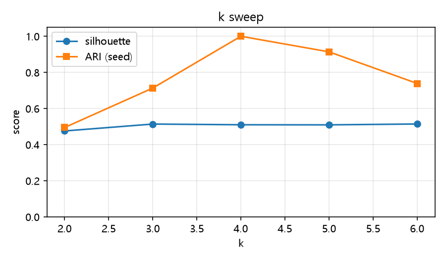
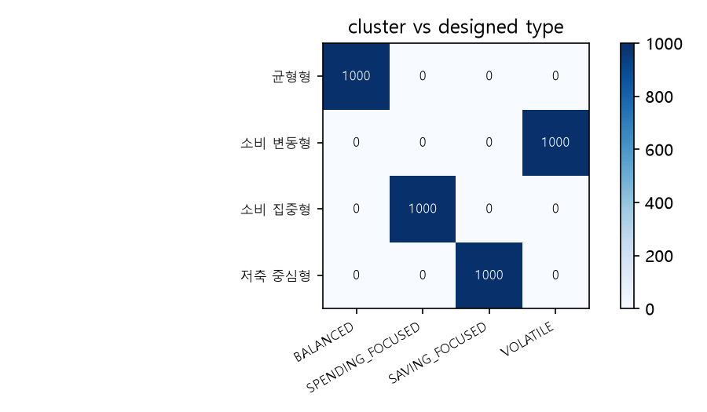

# 소비 유형 군집 모델 평가 (2026-09-14T10:15:34)

- 기간 2026-03 ~ 2026-08 (6개월), 표본 4000명, seed 정답 라벨 4000명, min-user-months 3
- 최종 k = 4, 실루엣 0.51, ARI 1.0, NMI 1.0, purity 1.0
- 재학습 안정성(random_state 5회): 실행 간 ARI 평균 1.0, 최소 1.0
- seed는 성향별 소비 패턴을 뚜렷하게 만든 합성 데이터라 지표가 높게 나온다. 발표에서는 합성 데이터 기준임을 명시한다.

## 1. k 탐색

| k | inertia | silhouette | ari | nmi | purity | labeledSamples |
| --- | --- | --- | --- | --- | --- | --- |
| 2 | 9520.048 | 0.4757 | 0.4948 | 0.6532 | 0.5 | 4000 |
| 3 | 6532.3715 | 0.5139 | 0.7132 | 0.8532 | 0.75 | 4000 |
| 4 | 4639.153 | 0.51 | 1.0 | 1.0 | 1.0 | 4000 |
| 5 | 3705.6397 | 0.5095 | 0.9137 | 0.9415 | 1.0 | 4000 |
| 6 | 2806.3808 | 0.5143 | 0.7387 | 0.8253 | 0.9563 | 4000 |

## 2. 특징 ablation (하나씩 제외, 표준화 O)

| features | dimensions | inertia | silhouette | ari | nmi | purity | labeledSamples |
| --- | --- | --- | --- | --- | --- | --- | --- |
| all | 5 | 4639.153 | 0.51 | 1.0 | 1.0 | 1.0 | 4000 |
| -spendingToIncomeRatio | 4 | 2743.6192 | 0.5314 | 0.8832 | 0.8908 | 0.952 | 4000 |
| -savingRate | 4 | 3790.764 | 0.4942 | 0.6805 | 0.7586 | 0.7995 | 4000 |
| -fixedExpenseShare | 4 | 3277.9309 | 0.5467 | 1.0 | 1.0 | 1.0 | 4000 |
| -discretionaryShare | 4 | 3236.343 | 0.5522 | 1.0 | 1.0 | 1.0 | 4000 |
| -spendingVolatility | 4 | 3260.6986 | 0.4609 | 0.6297 | 0.7096 | 0.74 | 4000 |

## 3. 전처리 ablation

| clipping | standardization | inertia | silhouette | ari | nmi | purity | labeledSamples |
| --- | --- | --- | --- | --- | --- | --- | --- |
| True | True | 4639.153 | 0.51 | 1.0 | 1.0 | 1.0 | 4000 |
| True | False | 77.5671 | 0.4532 | 0.6688 | 0.7514 | 0.7705 | 4000 |
| False | True | 4639.153 | 0.51 | 1.0 | 1.0 | 1.0 | 4000 |
| False | False | 77.5671 | 0.4532 | 0.6688 | 0.7514 | 0.7705 | 4000 |

## 4. 최종 구성 혼동행렬 (라벨은 중심값 순위 정책)

| 군집 \ 설계 성향 | BALANCED | SPENDING_FOCUSED | SAVING_FOCUSED | VOLATILE | 합 |
| --- | --- | --- | --- | --- | --- |
| 균형형 | 1000 | 0 | 0 | 0 | 1000 |
| 소비 변동형 | 0 | 0 | 0 | 1000 | 1000 |
| 소비 집중형 | 0 | 1000 | 0 | 0 | 1000 |
| 저축 중심형 | 0 | 0 | 1000 | 0 | 1000 |

## 5. 배포 아티팩트 `spending-kmeans-v1` (python-sklearn-1.9.0, 2026-09-14T10:15:24)

- 학습 표본 4000, 평가 표본 4000, 실루엣 0.51, ARI 1.0, purity 1.0
- 신뢰도 평균 0.6137, 중앙 0.6091, p10 0.369, 최소 0.0918
- 노출 조건: 신뢰도 < 0.2 비율 0.0118, 표본 < 10 군집 배정 비율 0.0, 군집 노출 비율 0.9882
- 군집별 배정 비율: {'균형형': 0.25, '소비 변동형': 0.25, '소비 집중형': 0.25, '저축 중심형': 0.25}

| 군집 \ 설계 성향 | BALANCED | SPENDING_FOCUSED | SAVING_FOCUSED | VOLATILE | 합 |
| --- | --- | --- | --- | --- | --- |
| 균형형 | 1000 | 0 | 0 | 0 | 1000 |
| 소비 변동형 | 0 | 0 | 0 | 1000 | 1000 |
| 소비 집중형 | 0 | 1000 | 0 | 0 | 1000 |
| 저축 중심형 | 0 | 0 | 1000 | 0 | 1000 |

## 그림

