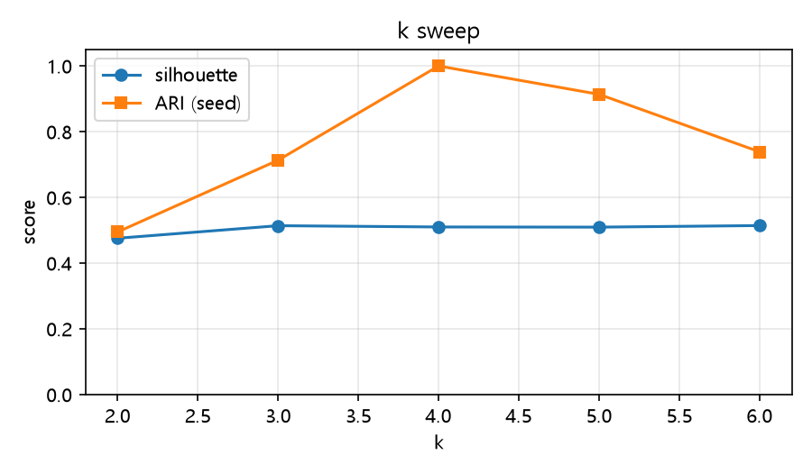

# 소비 유형 군집 모델 평가 (2026-09-14T10:14:47)

- 기간 2026-03 ~ 2026-08 (6개월), 표본 4000명, seed 정답 라벨 4000명, min-user-months 3
- 최종 k = 6, 실루엣 0.5143, ARI 0.7387, NMI 0.8253, purity 0.9563
- 재학습 안정성(random_state 5회): 실행 간 ARI 평균 0.8781, 최소 0.7004
- seed는 성향별 소비 패턴을 뚜렷하게 만든 합성 데이터라 지표가 높게 나온다. 발표에서는 합성 데이터 기준임을 명시한다.

## 1. k 탐색

| k | inertia | silhouette | ari | nmi | purity | labeledSamples |
| --- | --- | --- | --- | --- | --- | --- |
| 2 | 9520.048 | 0.4757 | 0.4948 | 0.6532 | 0.5 | 4000 |
| 3 | 6532.3715 | 0.5139 | 0.7132 | 0.8532 | 0.75 | 4000 |
| 4 | 4639.153 | 0.51 | 1.0 | 1.0 | 1.0 | 4000 |
| 5 | 3705.6397 | 0.5095 | 0.9137 | 0.9415 | 1.0 | 4000 |
| 6 | 2806.3808 | 0.5143 | 0.7387 | 0.8253 | 0.9563 | 4000 |

## 2. 특징 ablation (하나씩 제외, 표준화 O)

| features | dimensions | inertia | silhouette | ari | nmi | purity | labeledSamples |
| --- | --- | --- | --- | --- | --- | --- | --- |
| all | 5 | 2806.3808 | 0.5143 | 0.7387 | 0.8253 | 0.9563 | 4000 |
| -spendingToIncomeRatio | 4 | 1502.757 | 0.5335 | 0.6922 | 0.8023 | 0.9317 | 4000 |
| -savingRate | 4 | 2019.7627 | 0.5112 | 0.4721 | 0.6746 | 0.7995 | 4000 |
| -fixedExpenseShare | 4 | 2031.0684 | 0.543 | 0.8189 | 0.8892 | 1.0 | 4000 |
| -discretionaryShare | 4 | 1992.1703 | 0.5515 | 0.8189 | 0.8892 | 1.0 | 4000 |
| -spendingVolatility | 4 | 1725.8327 | 0.5089 | 0.4591 | 0.6683 | 0.7605 | 4000 |

## 3. 전처리 ablation

| clipping | standardization | inertia | silhouette | ari | nmi | purity | labeledSamples |
| --- | --- | --- | --- | --- | --- | --- | --- |
| True | True | 2806.3808 | 0.5143 | 0.7387 | 0.8253 | 0.9563 | 4000 |
| True | False | 45.5874 | 0.4872 | 0.4573 | 0.668 | 0.7705 | 4000 |
| False | True | 2806.3808 | 0.5143 | 0.7387 | 0.8253 | 0.9563 | 4000 |
| False | False | 45.5874 | 0.4872 | 0.4573 | 0.668 | 0.7705 | 4000 |

## 4. 최종 구성 혼동행렬 (라벨은 중심값 순위 정책)

| 군집 \ 설계 성향 | BALANCED | SPENDING_FOCUSED | SAVING_FOCUSED | VOLATILE | 합 |
| --- | --- | --- | --- | --- | --- |
| 소비 변동형 | 0 | 0 | 0 | 455 | 455 |
| 고정지출 집중형 | 579 | 0 | 0 | 0 | 579 |
| 저축 중심형 | 0 | 0 | 825 | 0 | 825 |
| 소비 집중형 | 0 | 1000 | 0 | 0 | 1000 |
| 균형형 | 0 | 0 | 0 | 545 | 545 |
| 재량소비 집중형 | 421 | 0 | 175 | 0 | 596 |

## 5. 배포 아티팩트 `spending-kmeans-v1` (python-sklearn-1.9.0, 2026-09-14T10:14:35)

- 학습 표본 4000, 평가 표본 4000, 실루엣 0.5143, ARI 0.7387, purity 0.9563
- 신뢰도 평균 0.6204, 중앙 0.6631, p10 0.2964, 최소 0.0016
- 노출 조건: 신뢰도 < 0.2 비율 0.0563, 표본 < 10 군집 배정 비율 0.0, 군집 노출 비율 0.9437
- 군집별 배정 비율: {'소비 변동형': 0.1138, '고정지출 집중형': 0.1447, '저축 중심형': 0.2062, '소비 집중형': 0.25, '균형형': 0.1363, '재량소비 집중형': 0.149}

| 군집 \ 설계 성향 | BALANCED | SPENDING_FOCUSED | SAVING_FOCUSED | VOLATILE | 합 |
| --- | --- | --- | --- | --- | --- |
| 소비 변동형 | 0 | 0 | 0 | 455 | 455 |
| 고정지출 집중형 | 579 | 0 | 0 | 0 | 579 |
| 저축 중심형 | 0 | 0 | 825 | 0 | 825 |
| 소비 집중형 | 0 | 1000 | 0 | 0 | 1000 |
| 균형형 | 0 | 0 | 0 | 545 | 545 |
| 재량소비 집중형 | 421 | 0 | 175 | 0 | 596 |

## 그림

