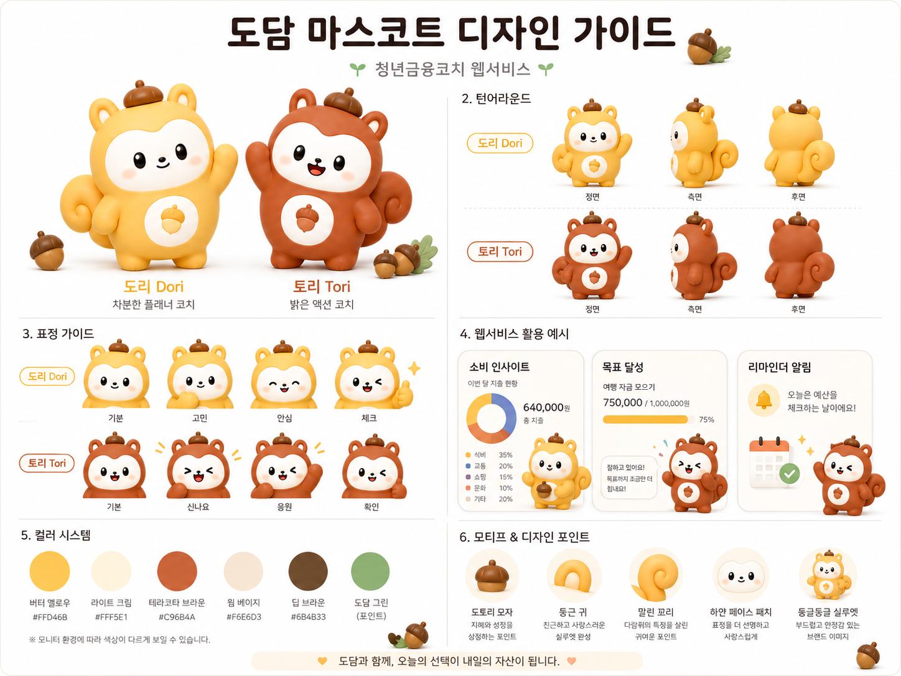

# 기획안 작성

날짜: 2026년 8월 25일 → 2026년 8월 28일
태그: PLAN
DONE?: Yes

# 금융코치 기획안

## 1. 서비스 기본 정의

### 1-1. 서비스명

- ~~피코(personal financial coach)~~
- ~~핀코(financial coach)~~
- **도담 - 도리(), 토리()**
    - 어린아이가 탈 없이 잘 놀며 자라는 모양
    - 그 의미를 가져와서 청년의 금융생활과 자산이 무리 없이 건강하게 잘 자라도록 돕는다는 뜻
    
    
    

---

## 1. 서비스 개요

### 1-2. 한 줄 소개

사용자가 설정한 금융 목표를 기준으로 현재 금융생활에서 목표 달성을 방해하는 요인을 찾고, 개선 시나리오별 목표 달성 시점의 변화를 보여주며 지속적으로 관리해주는 금융 코치

### 1-3. 서비스 핵심 키워드

- 금융목표
- 자산형성
- 자산관리
- 금융코칭
- 금융선택
- 지속관리

### 1-4. 서비스가 해결하려는 핵심 문제

- 사용자는 여러 금융상품과 소비를 동시에 관리하지만, 각각의 정보를 확인하는 것만으로는 **현재 금융상태가 자신의 목표 달성에 어떤 영향을 미치는지 판단하기 어렵다.**
- 소비, 대출이자, 금융상품, 유휴자금 등 여러 요인이 동시에 존재하기 때문에 **어떤 항목부터 개선해야 효과적인지 판단하기 어렵다.**
- 금융상품이나 소비 현황을 확인할 수 있더라도 이를 **개인의 금융목표와 연결하여 구체적인 행동으로 이어가기 어렵다.**
- 따라서 사용자의 금융현황과 목표를 함께 분석하여 **목표 달성을 방해하는 요인을 발견하고, 개선 행동에 따른 목표 달성 시점의 변화를 제시한다.**

### 1-5. 서비스가 제공하는 핵심 가치

- **목표 중심의 금융관리**
- **금융 선택의 효과를 수치로 확인**
- **실행 이후 지속적인 목표 관리**

### 1-6. 금융교육 / 자산관리 / 금융비서 / 금융코치 중 서비스 포지셔닝

- **자산관리**
- **금융코치**

---

## 2. 타깃 사용자 정의

### 2-1. 서비스 타깃

- 금융목표를 설정하고 자신의 금융생활을 개선하고 싶은 사용자
- 일정한 소득을 바탕으로 소비, 저축, 대출 등 여러 금융활동을 관리하는 사용자
- 특정 연령층으로 서비스를 제한하지 않으며, 사용자의 생애주기와 금융상황에 따라 다른 목표와 개선안을 제공한다.

### 2-2. 초기 대표 페르소나

- MVP 기획 및 사용자 시나리오 구체화를 위해 **사회초년생을 대표 페르소나로 설정한다.**
- 사회초년생은 소득이 발생하기 시작하면서 소비, 저축, 카드, 대출 등 다양한 금융 의사결정을 처음 본격적으로 경험하는 사용자군이다.
- 서비스 자체의 이용 대상을 사회초년생으로 제한하지 않는다.

### 2-3. 소득 수준

- 일정한 소득이 발생하는 사용자
- 사용자의 소득 수준에 따라 소비·저축·대출 부담과 목표 달성 가능성을 개별적으로 분석한다.
- 대표 페르소나 기준 월 실수령 약 230만 원

### 2-4. 금융상품 보유 수준

- 예·적금
- 체크카드 및 신용카드
- 대출
- 청약통장 등 하나 이상의 금융상품을 이용하는 사용자

### 2-5. 부채 보유 여부

- 부채 보유 여부와 관계없이 사용 가능
- 대출을 보유한 경우 금리, 상환액, 상환일 등을 추가적으로 분석한다.

### 2-6. 금융지식 수준

- 기본적인 예·적금, 카드, 대출 등의 개념은 알고 있으나 금융상품을 직접 비교하고 자신의 상황에서 어떤 선택이 유리한지 판단하는 데 어려움을 느끼는 사용자
- 자신의 금융정보는 확인할 수 있지만 **어떤 행동을 먼저 해야 하는지 판단하기 어려운 사용자**

### 2-7. 대표 사용자 페르소나

- 김다미 / 27세 / 부산
- 취업 6개월 차
- 월 실수령 약 230만 원
- 월세 50만 원
- 학자금대출 600만 원
- 적금 월 50만 원
- 체크카드 2개, 신용카드 1개 사용
- 여러 OTT 및 정기결제 이용
- 일정한 저축은 하고 있지만 자신의 현재 금융상태가 목표 달성에 적절한지 판단하기 어려움
- 여러 개선 방법 중 무엇을 먼저 실행해야 하는지 판단하기 어려움

> **대표 페르소나는 서비스의 전체 타깃을 의미하지 않으며, MVP 사용자 시나리오를 구체화하기 위한 초기 사용자 유형으로 활용한다.**
> 

### 2-8. MVP에서 다루지 않는 금융상황

- 사업자 사업자금 관리
- 투자 포트폴리오 전문 관리
- 보험 리모델링
- 복잡한 세무·상속·증여 자산관리

---

## 3. 문제 정의

### 3-1. 금융정보는 있지만 목표와 연결되지 않는 문제

사용자는 자산, 소비, 대출, 예·적금 등 자신의 금융현황을 확인할 수 있지만, 현재 금융생활이 자신이 설정한 금융 목표를 달성하기에 적절한 상태인지 판단하기 어렵다.

### 3-2. 무엇부터 개선해야 하는지 판단하기 어려운 문제

소비 증가, 높은 금융비용, 낮은 자금 활용 효율 등 여러 개선 가능성이 동시에 존재할 경우 어떤 항목부터 개선해야 자신의 목표 달성에 가장 효과적인지 판단하기 어렵다.

### 3-3. 금융 선택의 결과를 미리 알기 어려운 문제

소비를 줄이거나 대출·예적금 조건을 변경하는 등의 금융 행동을 하더라도 해당 선택이 실제 자산형성과 목표 달성에 얼마나 영향을 미치는지 직관적으로 확인하기 어렵다.

### 3-4. 추천 이후의 지속적인 관리가 부족한 문제

금융상품이나 개선 방법을 추천받더라도 사용자가 실제로 해당 행동을 실행했는지, 실행 이후 금융상태가 얼마나 개선되었는지 지속적으로 관리하기 어렵다.

### 3-5. 금융위험을 사전에 인지하기 어려운 문제

카드결제, 대출상환, 적금납입, 월세 등 여러 예정 지출이 겹치면서 특정 시점에 단기적인 현금 부족이 발생할 수 있지만 이를 사전에 파악하기 어렵다.

### 3-6. 기존 자산관리 서비스의 한계

기존 자산관리 서비스가 금융현황과 소비내역을 파악하는 데 강점이 있다면, 본 서비스는 **사용자의 목표를 기준으로 개선요인을 탐지하고 → 행동별 효과를 비교하고 → 실행 이후 변화까지 지속적으로 추적하는 것**에 초점을 둔다.

---

## 4. 핵심 문제의 우선순위

### 4-1. 반드시 해결할 문제

- 사용자의 **금융목표와 현재 금융상태의 차이를 파악**한다.
- 목표 달성을 방해하는 금융요인을 발견한다.
- 개선 가능한 행동별로 **목표 달성에 미치는 효과를 계산**한다.
- 효과가 높은 행동부터 우선순위를 제시한다.
- 사용자가 선택한 행동의 실행 결과를 지속적으로 추적한다.

### 4-2. 있으면 좋은 기능

- 정기결제 점검
- 금융상품 비교
- 납부일 통합 관리
- 유휴자금 활용
- 카드 혜택 분석
- 정책지원 추천
- 여러 개선 행동을 조합한 금융 시나리오 비교

### 4-3. MVP에서 제외하거나 후순위로 둘 문제

- 주식투자
- 실제 대환대출 실행
- 투자 종목 추천
- 보험 리모델링
- 고도화된 신용평가
- 실제 정책지원 자동 신청
- 자동 자금 이동

※ 금융상품 조회 및 비교는 `금융상품 한눈에` 등의 공개 데이터를 활용하여 구현을 검토한다.

### 4-4. 금융 비효율의 정의

- **사용자의 목표 달성을 방해하거나 불필요한 금융비용 또는 금융위험을 발생시키는 상태**
- 금융 비효율을 단순히 특정 기준을 초과한 상태로 단정하지 않고, 사용자의 목표와 현재 금융상태를 함께 고려하여 판단한다.

#### 금융 비효율의 주요 유형

- **목표 이탈**
    - 사용자가 설정한 소비·저축 목표와 현재 상태에 차이가 발생한 경우
- **현금흐름 위험**
    - 예정된 카드결제, 대출상환, 적금납입 등으로 인해 특정 시점에 자금 부족 가능성이 발생한 경우
- **금융비용**
    - 상대적으로 높은 대출금리, 현금서비스 등으로 불필요한 금융비용이 발생하고 있는 경우
- **개선 기회**
    - 유휴자금, 낮은 예·적금 금리 등 현재보다 효율적으로 자금을 활용할 가능성이 존재하는 경우

### 4-5. 개선 효과 측정 기준

- 목표 달성 예상 시점
- 개선 전·후 목표 달성 예상 시점 차이
- 월 가용자금 증가액
- 월 금융비용 절감액
- 목표 소비금액 대비 실제 소비금액
- 목표 저축 필요금액 대비 실제 저축금액
- 예정 입출금 반영 후 현금흐름 안정성
- 카테고리별 소비금액 및 소비 비중 변화

#### 예시

```
현재 예상 목표 달성일
2029.02.13

외식비 월 10만원 감소
→ 예상 목표 달성일 2028.12.20
→ 목표 달성 55일 단축

대출 금융비용 감소
→ 예상 목표 달성일 2028.12.02
→ 추가 18일 단축

두 행동을 함께 실행할 경우
→ 예상 목표 달성일 2028.10.15
→ 기존 대비 총 121일 단축
```

---

## 5. 서비스 핵심 컨셉

[ㅇㅇㅇ](https://app.notion.com/p/3c9bb6ea3564804bafe0e3e774a084fe?pvs=21)

사용자가 설정한 금융 목표를 중심으로 **현재 금융상태를 진단하고, 목표 달성을 방해하는 요인을 탐지한 뒤, 개선 행동에 따른 목표 달성 시점의 변화를 계산하여 실행과 지속적인 관리까지 연결한다.**

### 전체 서비스 흐름

```
목표 설정
↓
금융현황 진단
↓
목표 달성 방해요인 및 금융위험 탐지
↓
개선 시나리오 생성
↓
목표 달성 영향 분석 및 우선순위 제시
↓
사용자의 행동 선택
↓
실행
↓
**변화 추적**
↓
목표 달성 시점 재예측
↓
다음 개선 행동 제안
```

### 5-1. 금융 현황 진단

- 사용자의 계좌, 소비, 대출, 카드, 예·적금 정보를 통합하여 **자산·소비·부채·저축 현황을 한 화면에서 파악**한다.
- 사용자는 자신의 금융생활에 맞는 목표를 설정할 수 있다.
    - **모으기 목표**: 특정 시점까지 목표 금액을 모으는 것을 목표로 설정한다.
        - 목표명
        - 목표 금액
        - 목표일
        - 현재 확보 금액(사용자 임의 추가)
        - 목표 달성을 위해 필요한 월 저축액 (계산)
    - **줄이기 목표**: 한 달 동안 사용할 소비 목표 금액을 설정한다.
        - 월 소비 목표 금액
        - 현재 월 누적 소비금액
        - 남은 소비 가능 금액
- 모으기·줄이기 목표를 바탕으로 **목표 소비·저축 비율을 자동 계산**하고 실제 소비·저축 현황과 비교한다.
- 소비금액에는 **카드결제, 계좌이체 등 실제 지출 전체**를 포함한다.
- 설정한 목표와 실제 금융 현황의 차이를 이후 금융 비효율 탐지 및 개선안 추천에 활용한다.

#### 소비 성향 검사

- 

#### 계좌

- 총 보유자산
- 월 소득
- 계좌별 잔액
- 입출금 내역

#### 소비

- 월 총 소비금액
- 월 고정지출
    - 월세
    - 통신비
    - 정기결제 등
- 월 변동지출
    - 식비
    - 생활비
    - 문화생활비 등
- 결제수단별 소비
    - 카드결제
    - 계좌이체
- 카테고리별 소비
- 소비 : 저축 목표 비율 대비 현재 비율

**카드결제**

- 최근 카드 결제일 이후부터 현재까지의 누적 사용금액
- 카드 API를 통해 사용내역 수집

**계좌이체**

- 은행 API를 통해 거래내역 및 이체메모 수집
- 이체메모 등을 기반으로 소비 카테고리 자동 분류
- 필요 시 사용자가 직접 카테고리 수정

**카드 할부**

- 현재 할부 내역
- 잔여 할부금
- 잔여 개월 수
- 월별 예정 결제금액

#### 대출

- 총 대출잔액
- 대출별 잔액
- 금리
- 대출유형
    - 1금융권
    - 2금융권
    - 할부금융 등
- 월 상환액
- 상환 방식
    - 원금균등
    - 원리금균등
    - 만기일시
- 상환일
- 만기일

#### 카드

- 보유카드 현황
- 카드별 연회비
- 카드별 주요 혜택
- 현금서비스 이용 여부 및 잔액

#### 예·적금

- 보유 예·적금 현황
- 현재 잔액
- 월 납입액
- 적용 금리
- 납입기간
- 만기일
- 예상 만기금액

### 5-2. 금융 비효율 탐지

- 5-1에서 수집한 금융 현황과 사용자가 설정한 목표를 바탕으로 **목표 달성 위험, 불필요한 비용, 활용되지 않는 자금, 과도한 금융비용, 현금흐름 위험**을 탐지한다.
- 비효율 탐지 단계에서는 문제 가능성이 있는 항목을 식별하며, 구체적인 해결 방법은 이후 개선안 추천 단계에서 제시한다.
- 서비스에서 임의로 비효율이라고 단정하기보다 사용자의 목표, 과거 금융 패턴 및 현재 금융상태를 기준으로 **점검이 필요한 항목**을 탐지한다.
- 탐지는 **규칙 기반 탐지를 1차 기준**으로 하고, 익명·집계된 소비 특징으로 분류한 **소비 유형 군집의 정상 범위와 비교하는 보조 탐지(Hybrid)** 를 함께 사용한다. 군집 결과는 규칙 기반 결과를 대체하지 않으며, 데이터가 부족하거나 모델이 실패하면 규칙 기반 결과만으로 진단한다.

#### 목표

- **모으기 목표 달성 위험**
    - 필요 데이터
        - 목표 금액
        - 목표일
        - 현재 확보 금액
        - 현재 월 저축액
    - 파생 데이터
        - 목표일까지 남은 기간
        - 남은 목표 금액
        - 목표 달성을 위해 필요한 월 저축액
        - 현재 저축속도 기준 예상 목표일 또는 예상 달성금액
    - 탐지
        
        ```
        모으기 목표, 계좌를 1:N의 관계로 설정해서 모으기 목표에 특정 계좌를 연결해서 합산한 금액으로 설정 (계좌는 정기 예적금, 자유입출금 등 - 증권 계좌는 제외)
        - 2안: 24개월 2400만원을 모은다 하면 1개월당 100만원을 모아야 하므로 차액을 계산해서 탐지 (기준일은 사용자가 선택)
         + **자유입출금통장의 경우 출금을 할 경우 경고메시지 출력할 것.**
        ```
        
    - 예시
        - 알람 방식에 대해서는 더 고민해봐야할 듯. → 토스의 경우 임의로 하나씩 출력, 성향검사 기반 우선순위 고려해서
        
        ```
        2027년 12월까지 1,000만원을 모으는 것이 목표입니다.
        
        현재까지 300만원을 확보했으며
        목표 달성을 위해 매월 약 43만원의 저축이 필요합니다.
        
        현재 월평균 저축액은 35만원으로
        현재 저축속도가 유지될 경우 목표금액에 미달할 가능성이 있습니다.
        ```
        
- **줄이기 목표 초과 위험**
    - 필요 데이터
        - 월 소비 목표 금액
        - 현재 월 누적 소비금액
        - 최근 일별 소비내역
        - 이번 달 남은 기간
    - 파생 데이터
        - 남은 소비 가능 금액
        - 현재 소비속도 기준 예상 월 소비금액
    - 탐지
        
        ```
        현재 월 누적 소비금액 > 월 소비 목표 금액
        
        OR
        
        현재 소비속도 기준 예상 월 소비금액 > 월 소비 목표 금액
        ```
        
    - 예시
        
        ```
        이번 달 소비 목표는 120만원입니다.
        
        현재까지 83만원을 사용했으며
        이번 달 남은 소비 가능금액은 37만원입니다.
        
        현재 소비속도가 유지될 경우
        약 138만원을 사용할 것으로 예상됩니다.
        ```
        
    - 소비목표의 N%이하로 N개월 유지 시 소비목표 하향 제안 (N → 추후 논의 필요)

---

#### 계좌

- 보유자산
    - 필요 데이터
        - 보유 현금
        - + 저축금액
        - - 대출금액
    - 파생 데이터
        - 
    - 탐지
        
        ```
        총 자산 = 보유 현금 + 저축 금액 - 대출 금액
        ```
        
    - 예시
        
        ```
        금액만 출력
        ```
        
- **휴면성 소액계좌**
    - 필요 데이터
        - 계좌 목록
        - 계좌별 잔액
        - 최근 입출금 일자
    - 탐지(확정)
        
        ```
        잔액 > 0
        AND
        최근 N개월간 입출금 거래 없음
        ```
        
    - 예시
        
        ```
        최근 8개월간 거래가 없는 계좌 2개에
        총 37만원이 남아 있습니다.
        ```
        

---

#### 소비

- **고정지출 증가**
    - 필요 데이터
        - 월 고정지출
        - 고정지출 항목
        - 최근 3~6개월 결제이력
    - 파생 데이터
        - 최근 평균 고정지출
        - 이전 평균 고정지출
        - 항목별 증감금액 및 증감률
    - 탐지
        
        ```
        최근 1~2개월 평균 고정지출
        >
        이전 3개월 평균 고정지출 × (1 + 기준 증가율)
        
        예) 고정지출이 10만원 / 기준 증가율이 0.2일 때, 고정지출이 12만원이 되면 탐지
        기준증가율은 소액, 고액의 기준에 따라 보정계수가 필요할 듯...
        ```
        
    - 예시
        
        ```
        최근 월 고정지출이 63만원으로
        이전 3개월 평균 54만원 대비 약 16.7% 증가했습니다.
        
        주요 증가 항목
        - 통신비 +23,000원
        - 정기결제 +19,000원
        - 보험료 +48,000원
        ```
        
- **변동지출 급증**
    - 필요 데이터
        - 소비 거래내역
        - 거래 카테고리
    - 파생 데이터
        - 월별 카테고리별 지출금액
        - 카테고리별 최근/과거 평균 지출
    - 탐지
        
        ```
        최근 N개월 카테고리 평균지출
        >
        이전 N개월 카테고리 평균지출 × (1 + 기준 증가율)
        
        -> 소액, 고액 보정계수가 필요할 것 같다. + 물가상승률
        ```
        
    - 예시
        
        ```
        최근 3개월 배달·외식 지출이
        이전 3개월 대비 약 38% 증가했습니다.
        ```
        
- **특정 카테고리 소비 집중 → 경고메시지는 출력하지 않는다.**
    - 필요 데이터
        - 월 전체 소비금액
        - 카테고리별 소비금액
    - 파생 데이터
        - 전체 소비 중 카테고리별 소비 비중
    - 탐지
        
        ```
        특정 카테고리 소비금액 / 전체 소비금액
        >=
        기준 비율
        ```
        
    - 예시
        
        ```
        이번 달 변동지출 85만원 중
        배달·외식비가 38만원으로 약 44.7%를 차지하고 있습니다.
        ```
        

- **소비 유형 군집 범위 이탈 (보조 탐지)**
    - 필요 데이터
        - 최근 3~6개월 월별 소비금액, 카테고리별 소비금액
        - 고정지출·변동지출 금액
        - 소득, 월 저축액
    - 파생 데이터
        - 소득 대비 소비율, 저축률, 카테고리별 소비 비중
        - 고정지출 비중, 소비 변동성, 최근 증가율
        - 사용자가 속한 소비 유형 군집(군집 ID·라벨)
        - 군집별 특징 기준 범위(최소·최대, 이상치 보정용 5~95 분위수)
    - 탐지
        
        ```
        범위 이탈(f) =
          0                      (min ≤ x ≤ max)
          (min - x) / scale      (x < min)
          (x - max) / scale      (x > max)
        
        scale = max(군집 max-min, 해당 특징 표준편차)
        군집 이탈 점수 = Σ(가중치_f × 범위 이탈(f))
        
        노출 조건(모두 충족해야 사용자에게 노출)
        - 군집 표본 수 ≥ 최소 기준
        - 사용자 데이터 3개월 이상
        - 군집 분류 신뢰도(중심점 거리) 허용 범위 이내
        - 군집 이탈 점수 ≥ 임계값
        ```
        
    - 예시
        
        ```
        비슷한 소비 유형 사용자군의 외식·배달 비중은 12~31% 범위인데
        회원님은 44%로 상단 범위를 넘고 있어 점검이 필요합니다.
        (표본 842명 / 최근 6개월 기준 / 모델 spending-kmeans-v1)
        ```
        
    - 유의
        - 군집 범위를 벗어났다는 사실만으로 낭비라고 단정하지 않고 목표·소득·생활조건과 함께 해석한다.
        - 규칙 기반 탐지와 카테고리가 같으면 이슈를 새로 만들지 않고 근거만 병합한다.
        - 표본 수가 작은 군집의 범위는 노출하지 않는다.

---

#### 대출

- **고금리 부채 식별**
    - 필요 데이터
        - 대출잔액
        - 적용금리
        - 대출상품 종류
        - 금융기관 / 금융권
        - 대출 실행일
        - 만기일
        - 외부 유사 대출상품 금리 데이터
        - 신용점수
        - 기존 보유 대출상품
    - 탐지
        - 보유 대출을 금리순으로 비교
        - 서비스가 정의한 고금리 기준 이상인 대출을 우선 점검 대상으로 분류
        - 동일 사용자의 대출 간 금리 차이 비교
        - 외부 데이터 확보 시 동일 상품군·유사 조건 평균금리와 비교
        - 신용점수·소득·심사조건을 확인할 수 없으므로 대환 가능 여부는 확정하지 않음
        
        ```
        금리편차 = 현재 대출금리 - 조건별 시장 기준금리
        IF 금리편차 >= α(기준편차)
        α = 0.0%p -> 추후 결정
        
        기준금리(user)
        = 동일 대출종류, 동일 금융업권, 동일 신용점수 구간 에 해당하는 시장 평균 또는 중앙금리
        ```
        
        [은행연합회 소비자포털](https://portal.kfb.or.kr/compare/loan_household_new.php)
        
    - 예시
        
        ```
        사용자
        신용점수: KCB 823점
        대출: 은행 일반신용대출
        현재금리: 8.2%
        
        동일 조건 시장금리
        KCB 801~850점
        은행 일반신용대출 중앙금리: 6.1%
        
        금리차 = 8.2% - 6.1%
               = +2.1%p
        ```
        
- **이자비용 부담**
    - 필요 데이터
        - 대출잔액
        - 적용금리
        - 상환방식(원금균등, 원리금균등, 만기일시)
        - 남은 상환기간
        - 월 상환액
        - 원금·이자 상환내역
    - 파생 데이터
        - 향후 예상 이자비용
        - 대출별 이자비용 비중
    - 탐지
        - 현재 조건 유지 시 향후 예상 이자비용 계산
        - 대출별 예상 이자비용 비교
        - 전체 이자비용에서 차지하는 비중이 높은 대출 식별
    - 예시
        
        ```
        현재 대출을 그대로 유지하면
        향후 1년간 예상 이자비용은 약 82만원입니다.
        
        A 대출: 약 19만원
        B 대출: 약 51만원
        C 대출: 약 12만원
        
        전체 예상 이자비용 중
        B 대출이 약 62%를 차지합니다.
        ```
        
- **월 상환 부담**
    - 필요 데이터
        - 월 소득
        - 각 대출 월 상환액
        - 대출별 원금·이자 상환액
        - 월 고정지출
        - 월 저축액
    - 파생 데이터
        - 월 대출 상환 부담률
        - 대출·고정지출·저축 차감 후 가용금액
    - 탐지
        - 모든 대출 월 상환액 합산
        - 월 소득 대비 대출상환 비율 계산
        - 고정지출과 저축까지 반영하여 실제 가용금액 계산
        - 최근 몇 개월간 상환 부담 변화 추적
        
        ```
        월 대출 상환 부담률
        =
        (월 대출 상환액 / 월 소득) × 100
        ```
        
    - 예시
        
        ```
        월 소득 280만원 중
        대출 상환에 72만원이 사용되고 있습니다.
        
        월 상환 부담률: 25.7%
        
        고정지출과 저축까지 제외하면
        이번 달 가용금액은 약 64만원입니다.
        ```
        

---

#### 카드

- **사용 빈도가 낮고 연회비가 발생하는 카드**
    - 필요 데이터
        - 보유 카드 목록
        - 카드별 거래내역
        - 최근 사용일
        - 카드별 사용금액
        - 연회비(데이터 못 불러오면 결제내역으로 판별)
    - 탐지
        
        ```
        최근 N개월 사용횟수 <= 기준횟수
        
        OR
        
        최근 N개월 사용금액 <= 기준금액
        ```
        
        - 사용하지 않는 카드라고 확정하지 않고 보유 필요성 점검 대상으로 분류
        - 연회비가 발생하는 경우 우선적으로 표시
    - 예시
        
        ```
        연회비 15,000원이 발생하는 A카드는
        최근 5개월 동안 결제내역이 없습니다.
        
        보유 필요성을 점검해볼 수 있습니다.
        ```
        
- **카드 혜택 미활용 (혜택비교 및 추천 쪽으로 더 생각)**
    - 필요 데이터
        - 보유카드별 혜택
        - 카드별 전월실적 조건
        - 카드별 소비내역
        - 카테고리별 소비금액
    - 탐지
        - 사용자의 주요 소비 카테고리와 현재 보유카드의 혜택을 비교
        - 소비가 많이 발생하지만 관련 혜택을 받지 못하고 있는 항목을 점검 대상으로 분류
    - 예시
        
        ```
        최근 월평균 교통비는 18만원이지만
        현재 주 사용카드에는 교통비 할인 혜택이 없습니다.
        ```
        
- **카드 결제 부담**
    - 필요 데이터
        - 카드별 결제예정금액
        - 결제일
        - 월 소득
        - 최근 3~6개월 카드 결제금액
    - 파생 데이터
        - 월 카드 결제 부담률
    - 탐지
        - 모든 카드의 해당 월 결제예정금액 합산
        - 월 소득 대비 카드 결제예정금액 비율 계산
        - 과거 평균 대비 급격한 증가 여부 확인
        
        ```
        카드 결제 부담률
        =
        (이번 달 카드 결제예정액 / 월 소득) × 100
        ```
        
    - 예시
        
        ```
        이번 달 카드 결제예정액은 총 131만원입니다.
        
        월 소득 280만원의 약 46.8%가
        카드 결제에 사용될 예정입니다.
        ```
        

---

#### 예 · 적금

- **저축으로 인한 현금흐름 부담**
    - 필요 데이터
        - 예·적금 상품 목록
        - 월 납입액
        - 월 소득
        - 월 고정지출
        - 대출 상환액
    - 파생 데이터
        - 월 저축률
        - 저축·고정지출·대출상환 후 가용금액
    - 탐지
        - 단순히 저축률이 높다는 이유로 비효율로 판단하지 않음
        - 저축 이후 가용자금 부족이 반복되는 경우 점검 대상으로 분류
        
        ```
        저축·고정지출·대출상환 후 가용자금 <= 기준금액
        
        OR
        
        최근 반복적인 잔액 부족 발생
        ```
        
    - 예시
        
        ```
        월 소득 280만원 중
        매월 90만원을 적금에 납입하고 있습니다.
        
        고정지출과 대출상환까지 제외한
        월 가용금액은 약 64만원입니다.
        
        최근 단기 현금 부족이 반복되어
        저축 계획 점검이 필요합니다.
        ```
        
- **금리 비교 (신규가입)**
    - 필요 데이터
        - 현재 적용금리
        - 상품 종류
        - 가입일
        - 만기일
        - 현재 잔액
        - 외부 예·적금 상품 금리 데이터
        - 가능하다면 우대금리 적용 여부

---

#### 공통 현금흐름 위험 탐지

대출 상환, 카드 결제, 적금 납입의 잔액 부족 위험은 각각 별도의 예측 로직을 구현하지 않고 **공통 현금흐름 예측 로직**을 활용한다.

```
현재 계좌잔액
→ 예정 입금 반영
→ 카드대금 반영
→ 대출 상환 반영
→ 적금 납입 반영
→ 공과금 등 예정지출 반영
→ 날짜별 예상잔액 계산
→ 잔액 부족 시점 탐지
```

- **공통 현금흐름 예측 로직**
    - 필요 데이터
        - 계좌별 현재 잔액
        - 예정 입금 내역 및 날짜
        - 카드 결제예정금액 및 결제일
        - 대출 상환예정금액 및 상환일
        - 적금 납입금액 및 납입일
        - 공과금·정기결제 등 예정지출
    
    #### 계산
    
    ```python
    from datetime import date, timedelta
    from collections import defaultdict
    
    # =========================================================
    # 1. 입력 데이터
    # =========================================================
    
    current_balance = 1_000_000
    
    # 이미 알고 있는 미래 입출금
    scheduled_events = [
        {
            "date": date(2026, 9, 1),
            "type": "income",
            "category": "salary",
            "amount": 2_000_000,
            "name": "급여"
        },
        {
            "date": date(2026, 9, 5),
            "type": "expense",
            "category": "card",
            "amount": 1_200_000,
            "name": "신용카드 결제"
        },
        {
            "date": date(2026, 9, 10),
            "type": "expense",
            "category": "saving",
            "amount": 500_000,
            "name": "적금 납입"
        },
        {
            "date": date(2026, 9, 15),
            "type": "expense",
            "category": "loan",
            "amount": 1_000_000,
            "name": "대출 상환"
        }
    ]
    
    # 최근 거래 데이터를 통해 계산했다고 가정한
    # 요일별 평균 변동지출
    #
    # 0 = 월요일
    # 1 = 화요일
    # ...
    # 6 = 일요일
    
    weekday_avg_expense = {
        0: 30_000,
        1: 25_000,
        2: 28_000,
        3: 30_000,
        4: 45_000,
        5: 60_000,
        6: 40_000
    }
    
    # =========================================================
    # 2. 날짜별 이벤트 구성
    # =========================================================
    
    events_by_date = defaultdict(list)
    
    for event in scheduled_events:
        events_by_date[event["date"]].append(event)
    
    # =========================================================
    # 3. 날짜별 현금흐름 예측
    # =========================================================
    
    def forecast_cashflow(
            start_date,
            days,
            current_balance,
            events_by_date,
            weekday_avg_expense
    ):
        balance = current_balance
    
        result = []
        risks = []
    
        for i in range(days):
            current_date = start_date + timedelta(days=i)
    
            start_balance = balance
    
            # -------------------------------
            # 1. 예정 입금 먼저 반영
            # -------------------------------
    
            daily_events = events_by_date.get(current_date, [])
    
            income_events = [
                e for e in daily_events
                if e["type"] == "income"
            ]
    
            for event in income_events:
                balance += event["amount"]
    
            # -------------------------------
            # 2. 확정 예정 출금 처리
            # -------------------------------
    
            expense_events = [
                e for e in daily_events
                if e["type"] == "expense"
            ]
    
            for event in expense_events:
    
                balance_before_payment = balance
    
                # 출금 가능 여부 확인
                if balance_before_payment < event["amount"]:
    
                    shortage = (
                        event["amount"]
                        - balance_before_payment
                    )
    
                    risks.append({
                        "date": current_date,
                        "category": event["category"],
                        "name": event["name"],
                        "required_amount": event["amount"],
                        "expected_balance": balance_before_payment,
                        "shortage": shortage
                    })
    
                balance -= event["amount"]
    
            # -------------------------------
            # 3. 예상 생활비 반영
            # -------------------------------
    
            weekday = current_date.weekday()
    
            estimated_expense = (
                weekday_avg_expense.get(weekday, 0)
            )
    
            balance -= estimated_expense
    
            # -------------------------------
            # 4. 날짜별 결과 저장
            # -------------------------------
    
            result.append({
                "date": current_date,
                "start_balance": start_balance,
                "estimated_expense": estimated_expense,
                "end_balance": balance
            })
    
        return result, risks
    
    # =========================================================
    # 4. 실행
    # =========================================================
    
    forecast, risks = forecast_cashflow(
        start_date=date(2026, 8, 28),
        days=30,
        current_balance=current_balance,
        events_by_date=events_by_date,
        weekday_avg_expense=weekday_avg_expense
    )
    
    # =========================================================
    # 5. 결과 출력
    # =========================================================
    
    for day in forecast:
        print(
            day["date"],
            f"예상잔액: {day['end_balance']:,}원"
        )
    
    print("\n[현금흐름 위험]")
    
    for risk in risks:
        print(
            f"{risk['date']} "
            f"{risk['name']} "
            f"부족 예상: {risk['shortage']:,}원"
        )
    ```
    
- **[예·적금] 납입일 잔액 부족 위험**
    - 필요 데이터
        - 적금 납입일
        - 월 납입액
        - 출금계좌
        - 현재 계좌잔액
        - 납입일까지 예정된 입출금
    - 파생 데이터
        - 납입일 예상잔액
    - 탐지
        
        ```
        납입 직전 예상잔액 < 적금 납입예정액
        ```
        
    - 예시
        
        ```
        9월 10일 적금 50만원이 출금될 예정입니다.
        
        현재 현금흐름을 기준으로 계산하면 납입 직전 예상잔액은 약 32만원으로,
        약 10만원이 부족할 것으로 예상됩니다.
        ```
        
- **[대출] 상환일 잔액 부족 위험**
    - 필요 데이터
        - 대출 상환일
        - 상환예정금액
        - 상환계좌
        - 현재 계좌잔액
        - 상환일까지 예정된 입출금
    - 파생 데이터
        - 상환일 예상잔액
        - 상환 후 예상잔액
    - 탐지
        
        ```
        상환 직전 예상잔액 < 대출 상환예정금액
        ```
        
    - 예시
        
        ```
        9월 15일 대출 상환금 42만원이 출금될 예정입니다.
        
        현재 현금흐름을 기준으로 계산하면
        상환 직전 예상잔액은 약 28만원으로,
        약 14만원이 부족할 것으로 예상됩니다.
        ```
        
- **[신용카드] 결제일 잔액 부족 위험 → 사전 예방쪽으로 수정 필요**
    - 필요 데이터
        - 카드 결제일
        - 결제예정금액
        - 결제계좌
        - 현재 계좌잔액
        - 결제일까지 예정된 입출금
    - 파생 데이터
        - 결제일 예상잔액
        - 결제 후 예상잔액
    - 탐지
        
        ```
        결제 직전 예상잔액 < 카드 결제예정금액
        ```
        
    - 예시
        
        ```
        9월 12일 카드대금 86만원이 결제될 예정입니다.
        
        현재 현금흐름을 기준으로 계산하면
        결제 직전 예상잔액은 약 64만원으로,
        약 22만원이 부족할 것으로 예상됩니다.
        ```
        
- **[신용카드]현금서비스/리볼빙 이용 → 시뮬레이션으로 조정**
    - 필요 데이터
        - 현금서비스/리볼빙 이용 여부 (이거 못 받아올 거 같은데…)
        - 이용금액
        - 적용금리
        - 이용일
        - 상환예정일
        - 리볼빙 약정결제비율
        - 기존 카드 결제예정금액
    - 파생 데이터
        - 예상 이자비용
        - 다음 결제일 예상 청구금액
        - 이월 잔액
        - 이용 전·후 월별 예상잔액
    - 시뮬레이션
        
        ```
        예상 이자비용
        =
        이월 또는 이용금액 × 적용금리 × 이용기간 / 365
        ```
        
        ```
        이용 전 현금흐름
        vs
        현금서비스/리볼빙 이용 후 현금흐름
        ```
        
    - 예시
        
        ```
        카드대금 80만원 중 50만원을 리볼빙하면
        이번 달 결제 부담은 감소하지만,
        50만원이 다음 달 이후로 이월됩니다.
        
        적용금리를 반영하면 추가 이자비용이 발생하며,
        다음 달 카드 결제 부담이 증가할 수 있습니다.
        ```
        
- **[신용카드] 할부부담**
    - 필요 데이터
        - 할부 거래내역
        - 최초 결제금액
        - 할부개월
        - 남은 할부개월
        - 월별 할부 결제예정액
        - 향후 월별 예상 가용금액
    - 파생 데이터
        - 월별 총 할부 예정금액
        - 향후 확정된 할부부담
        - 월별 가용금액 대비 할부부담률
    - 탐지
        - 진행 중인 할부 건 합산
        - 향후 월별 할부 예정금액 계산
        - 향후 가용금액 대비 할부부담 확인
        
        ```
        월 할부 부담
        =
        진행 중인 모든 할부의 월 결제예정액 합계
        ```
        
        ```
        할부부담률
        =
        월 할부 예정금액 / 월 예상 가용금액
        ```
        
    - 예시
        
        ```
        현재 진행 중인 할부가 5건 있습니다.
        
        앞으로 4개월 동안
        매월 평균 약 31만원의 할부금이 예정되어 있습니다.
        ```
        

이를 통해 **카드대금 미납 위험, 대출 연체 위험, 적금 납입 실패 가능성**을 동일한 방식으로 사전에 탐지한다.

### 5-3. 개선안 추천

- `5-2 금융 비효율 탐지` 결과를 바탕으로 사용자에게 개선 가능한 행동을 추천한다.
- 단순 상품 추천이 아니라 **현재 금융상태에서 어떤 행동을 하면 얼마나 개선되는지**를 함께 제시한다.
- 추천 시 사용자가 설정한 `소비 : 저축 목표 비율`, 월 소득, 고정지출, 대출 상환액 등을 고려한다.
- 여러 개선안이 존재할 경우 예상 효과와 실행 난이도를 함께 제공한다.

#### 계좌

**유휴자금 활용 (보유자산 쪽으로 변경하기로 함)**

- 입출금 계좌에 필요 이상으로 유지되고 있는 자금이 있을 경우 활용방안 추천
- 비상자금을 제외한 여유자금을 예·적금 등으로 이동하도록 제안

예시

```
최근 3개월 동안 입출금 계좌에 평균 620만 원이 유지되고 있습니다.

월평균 지출 180만 원을 고려하면 
약 3개월치 생활비를 제외한 일부 금액을 별도로 운용할 수 있습니다.
```

**휴면성 소액계좌 정리**

- 장기간 거래가 없는 소액계좌 탐지 시 계좌 정리 또는 자금 이동 제안

---

#### 소비

**목표 소비 비율 초과**

- 사용자가 설정한 소비 : 저축 목표와 실제 비율 비교
- 소비가 목표치를 초과할 경우 초과 금액 및 주요 원인 카테고리 제시

예시

```
목표 소비 비율은 40%지만 이번 달 소비 비율은 52%입니다.

목표 수준을 맞추려면 약 38만 원의 소비 감소가 필요합니다.
```

**과다 소비 카테고리 개선**

- 전월 또는 최근 평균 대비 지출이 크게 증가한 카테고리 탐지
- 줄일 수 있는 금액을 제안

```
최근 3개월 평균보다 배달·외식비가 12만 원 증가했습니다.
```

**정기결제 점검**

- 지속적으로 결제되고 있는 구독·정기결제 목록 제시
- 사용 빈도 등을 확인하여 불필요한 서비스 해지 후보 추천

---

#### 대출

**고금리 대출 우선 상환**

- 여러 대출이 있을 경우 금리가 높은 대출부터 추가 상환하도록 추천
- 추가 상환 시 절감 가능한 예상 이자 제공

```
여유자금 100만 원을 연 8.2% 대출에 우선 상환하면 
기존 저금리 대출 상환보다 이자 절감 효과가 큽니다.
```

**대환 가능성 안내**

- 현재 대출금리와 이용 가능한 대출상품을 비교
- 더 낮은 금리의 상품이 존재할 경우 대환 후보 제시
- 실제 대환 가능 여부는 심사 결과에 따라 달라짐을 명시

**상환 부담 개선**

- 월 소득 대비 대출 상환액이 높은 경우 상환 부담을 표시
- 만기·상환일을 고려하여 향후 현금흐름 경고

---

#### 카드

**카드 혜택 최적화**

- 사용자의 실제 소비 카테고리와 보유카드 혜택 비교
- 현재 카드 혜택을 제대로 활용하고 있는지 분석

```
교통비 지출이 월 15만 원이지만 현재 카드의 교통 할인 혜택은 없습니다.
```

**불필요한 카드 정리**

- 사용실적이 낮고 연회비가 발생하는 카드 탐지
- 유지 비용과 실제 받은 혜택을 비교하여 정리 후보 제시

**현금서비스 개선**

- 현금서비스 이용 시 높은 금융비용 안내
- 상환 가능 여유자금이 있는 경우 우선 상환 대상으로 추천

---

#### 예·적금

**저축 목표 부족**

- 설정한 저축 목표와 실제 월 저축액 비교

```
목표 저축액은 월 120만 원이지만 현재 평균 저축액은 85만 원입니다.

매월 약 35만 원의 추가 저축이 필요합니다.
```

**예·적금 상품 비교**

- 현재 상품과 유사한 조건의 상품 비교
- 금리, 기간, 예상 만기금액 차이 제공

```
현재 적금은 연 3.2%이며 동일한 12개월 조건에서 더 높은 금리의 상품을 확인할 수 있습니다.
```

소비, 저축 비율 조정

- 소비 금액이 기준 소비 금액보다 적을 때 저축으로 제안을 할지? 소비목표 하향을 제안을 할지?

### 5-4. 개선 우선순위 제시

사용자에게 여러 금융 비효율이 동시에 발견될 수 있으므로, 단순히 개선안을 나열하지 않고 **사용자의 금융 목표와 개선 효과를 기준으로 실행 우선순위를 산정**한다.

#### 우선순위 판단 기준

- **금융 위험도**
    - 연체 가능성, 고금리 부채 등 즉시 대응이 필요한 문제인지 판단
- **예상 개선 효과**
    - 이자 절감액, 수수료 절감액, 추가 수익 가능 금액 등
- **목표 달성 기여도**
    - 사용자가 설정한 금융 목표의 달성 시점을 얼마나 앞당길 수 있는지
- **시급성**
    - 결제일, 대출 상환일, 상품 만기 등 시간적 제약이 있는지
- **실행 난이도**
    - 구독 해지처럼 즉시 가능한 행동인지, 대환대출처럼 추가 절차가 필요한 행동인지
- **소비 유형 군집 이탈 정도(보조 가중치)**
    - 같은 소비 유형 사용자군의 정상 범위를 얼마나 벗어났는지를 보조 신호로만 반영한다
    - `최종 점수 = 기존 규칙 점수 + α × 군집 이탈 점수` (군집 결과가 없으면 α = 0)

#### 우선순위 항목

- 

동일한 금융 비효율이라도 사용자의 자산·부채·소비 구조와 금융 목표에 따라 우선순위가 달라지도록 한다.

### ~~5-5. 실행 유도~~

기능 삭제

### 5-6. 개선 결과 추적 (핵심기능)

사용자가 개선안을 실행한 이후 실제 금융 상태가 어떻게 변화했는지를 추적한다.

단순히 `"잘했습니다"`와 같은 피드백을 제공하는 것이 아니라 **실행 전후의 금융 데이터를 비교하여 개선 효과를 수치화**한다.

#### 개선 결과 측정

- 절감된 이자
- 절감된 수수료 및 정기결제 비용
- 증가한 이자수익
- 증가한 총 자산
- 부채 감소액
- 월 소비금액 변화
- 저축 가능 금액 변화
- **금융목표 예상 달성 시점 변화**

#### 금융목표와 연결

개별 행동의 효과를 금액으로만 보여주는 것이 아니라 사용자가 설정한 목표와 연결한다.

```
비상금 1,000만원 만들기

기존 예상 달성일
2028년 3월

현재 예상 달성일
2027년 12월

D-DAY -> **주식차트모양? + 캐릭터 표정**, BAR 모양,  
→ 목표 달성 예상 시점 3개월 단축
```

#### 재진단

금융 상태는 지속적으로 변화하므로 일정 주기 또는 주요 금융 변화가 발생했을 때 다시 진단한다.

예:

- 급여 변화
- 신규 대출 발생
- 소비 패턴 변화
- 적금 만기
- 카드 사용 증가
- 계좌 잔액 변화

이를 통해

**진단 → 탐지 → 개선 → 실행 → 측정 → 재진단**

의 반복적인 금융관리 구조를 만든다.

### 5-7. AI 금융코치의 개입 구조 (핵심기능)

AI는 금융 데이터를 직접 계산하거나 모든 금융 문제를 임의로 판단하는 역할이 아니라, **정형화된 금융 분석 결과와 사용자의 금융 목표·행동 맥락을 연결하는 코치 역할**을 수행한다.

특히 금융 데이터의 수치 계산 및 명확한 조건 판단은 규칙·분석 로직에서 처리하고, AI는 이를 해석하고 개인화하는 역할을 담당한다.

#### 금융 현황 설명 - 데일리 브리핑 느낌

(사용자 설정 시간)에 전 날에 대한 금융생활 기록 요약 브리핑을 받는다.

- 요약 생성은 오전 4~6시

#### 탐지 결과 맥락 해석

탐지 과정에서 발견한 금융 비효율을 왜 문제가 될 수 있는지 설명한다.

- 로직참고
- 군집 기반 보조 탐지 결과도 **AI는 설명만 담당**한다. 군집 분류, 기준 범위 계산, 이탈 판정은 분석 엔진이 수행하고 AI에는 계산이 끝난 군집 라벨·기준 범위·표본 수·모델 버전만 입력한다.
- 군집 결과를 설명할 때는 "비슷한 소비 유형 사용자군 대비 점검이 필요한 항목"으로 표현하고 낭비로 단정하지 않는다.

#### 사용자별 개선안 개인화

동일한 금융상태라도 사용자의 목표에 따라 다른 개선안을 제시한다.

- 초기 금융성향검사를 바탕으로 사용자별 개선안을 개인화한다.

#### 우선순위 설명

시스템이 산정한 우선순위를 ~~AI가 자연어로 설명~~한다. → 템플릿 사용

- 성향검사 결과 기반으로 우선순위를 선정,

```
현재는 적금 상품 변경보다 대출 상환을 먼저 추천합니다.

대출 금리가 더 높아 상환했을 때의 비용 절감 효과가 크고,
사용자가 설정한 '부채 1,000만원 이하 만들기' 목표에도
직접적인 영향을 주기 때문입니다.
```

#### 실행 계획 생성

추천된 개선안을 사용자가 실제로 수행할 수 있는 행동 단위로 변환한다.

```
이번 달에는 다음 두 가지부터 진행해보세요.

1. 급여일 이후 생활비 3개월분을 제외한 자금 확인
2. 여유자금 중 일부를 대출 추가상환에 활용할 수 있는지 확인
```

#### 지속적인 금융 코칭(전체 회의 필요)

이전 추천 및 사용자의 실행 여부를 바탕으로 다음 금융 행동을 조정한다.

끝까지 금융 코칭을 한다. 이 부분에서 알고리즘은 깊게 생각을 해봐야할듯함.

예시

```
지난달에는 대출 50만원을 추가 상환했습니다.

현재 대출 부담이 감소했기 때문에
이번 달에는 비상자금 확보를 우선하는 방향이 적절합니다.
```

---

# 6. Main Feature — 금융 효율 진단

사용자가 설정한 금융 목표와 현재 금융생활을 함께 분석하여 **목표 달성을 방해하는 요인을 발견하고, 어떤 행동부터 개선해야 하는지 판단할 수 있도록 지원한다.**

단순히 자산·소비 현황을 보여주는 것이 아니라,

**금융 데이터 통합 → 금융 비효율 탐지 → 금융 효율 점수 → 개선 우선순위 → 개선안 및 예상 효과**

의 흐름으로 사용자의 현재 금융생활을 진단한다.

---

## 6-1. 금융 데이터 통합 및 현황 분석

사용자의 계좌, 소비, 카드, 대출, 예·적금 등 분산된 금융 데이터를 통합하고 사용자가 설정한 **금융 목표와 함께 현재 금융상태를 분석한다.**

### 분석 데이터

#### 수입·지출

- 월 소득
- 월 총 소비금액
- 고정지출
- 변동지출
- 카테고리별 소비
- 카드 결제금액
- 계좌이체 지출
- 월 저축액

#### 자산·부채

- 총 보유자산
- 계좌별 잔액
- 총 대출잔액
- 대출별 잔액 (대출이 여러 개일 경우)
- 금리
- 월 상환액

#### 금융상품

- 보유 예·적금
- 적용 금리
- 월 납입액
- 만기일
- 보유 카드
- 카드별 연회비 및 주요 혜택

#### 정기결제(제외할 수도 있음)

- 정기결제 목록
- 월 결제금액
- 최근 결제내역

#### 금융 목표

**모으기 목표**

- 목표 금액
- 목표일
- 현재 확보 금액
- 목표 달성을 위해 필요한 월 저축액
- 현재 저축속도 기준 예상 목표 달성일

**줄이기 목표**

- 월 소비 목표 금액
- 현재 월 누적 소비금액
- 남은 소비 가능 금액
- 현재 소비속도 기준 예상 월 소비금액

### 예시

```
금융 목표
2027년 12월까지 1,000만원 모으기

현재 확보 금액
300만원

목표 달성을 위해 필요한 월 저축액
43만원

현재 월평균 저축액
35만원
```

현재 금융상태를 단순 조회하는 데서 끝나지 않고,

```
현재 저축속도로 목표를 달성할 수 있는가?
현재 소비가 목표 수준을 벗어나고 있는가?
현재 금융비용이 목표 달성을 늦추고 있는가?
앞으로 예정된 지출을 감당할 수 있는가?
```

를 이후 분석의 기준으로 활용한다.

---

## 6-2. 목표 달성 영향 분석

- 현재 금융상태 유지 시 예상 목표 달성 시점
- 탐지된 요인이 목표 달성에 미치는 영향
- 목표 대비 부족 금액
- 목표 대비 부족 저축액
- 소비 초과 금액
- 금융비용으로 인한 목표 달성 지연

## 6-3. 금융 진단 결과

- 현재 가장 큰 목표 방해요인
- 주의가 필요한 금융위험
- 개선 가능한 금융영역
- 목표 달성 전망
- 이전 진단 대비 변화

---

# 7. Sub Feature

## 7-1. 예·적금 최적화

- 현재 보유 예·적금 분석
- 금리 및 만기 구조 분석
- 중도해지·추가납입 등 선택 비교

## 7-2. 대출 최적화

- 현재 대출 부담 분석
- 금리 및 상환구조 분석
- 추가상환·대환 가능성 비교

## 7-3. 카드 최적화

- 카드 이용패턴 분석
- 카드 혜택 활용도 분석
- 할부 부담 분석

## 7-4. 연체 예방

- 공통 현금흐름 예측
- 카드 결제일 잔액 부족 위험
- 대출 상환일 잔액 부족 위험
- 적금 납입일 잔액 부족 위험
- 위험 발생 전 사전 알림

## 7-5. 선택 전·후 금융 시뮬레이션

- 소비
- 할부
- 예·적금 가입·납입액 변경
- 대출 실행·추가상환 시 월 납입금 비교
- **금융 목표 달성 시점 변화 비교**

## 7-6. 금융리포트(월간 리포트, 데일리 브리핑)

- 월간리포트
    - 우리가 추천해 준 부분 중에 뭐가 개선됐는지
    - 추천해 주지 않은 부분에서도 개선된 점 적기
    - 사용자가 악화되었을 경우, 경각심 멘트(월간 금융생활 패턴 분석 기반 LLM)
    - 누적 소비 그래프(이번달)
    - 다음달 예상 비용(카드, 대출, 할부, 월세 등)
    - **월간 금융 생활로 인해서 목표까지 얼마나 단축되었는지**
    - 월간 금융생활 패턴 분석
- 데일리브리핑
    - 오늘 사용가능한 금액
        
        ```
        (한 달 소비목표 금액 - 현재까지 사용한 금액) / 남은 일 수
        ```
        
    - 전 날 금융생활 특이사항
        - 소비 급증
    - 오늘 발생할 고정 금액(월세, 통신비, 카드결제일, 대출상환일, 예적금 납부일)

---

# 8. AI 금융코치

## 8-1. AI 금융코치의 역할

- 금융현황 분석 결과 전달
- 금융현황 요약
- 금융 비효율 원인 설명
- 추천 근거 설명
- 사용자 질문 응답
- 행동 유도

## 8-2. 금융현황 및 문제 설명

- 현재 금융상태 요약
- 발견된 금융 비효율 설명
- 비효율이 발생한 원인 설명
- 개선하지 않을 경우 발생할 수 있는 영향 설명

## 8-3. 추천 근거 설명

- 규칙 기반 함수 반환값 기반으로 parameter로 넣은 후 할루시네이션 방지 가능 - 룰베이스만으로도 가능
- 해당 행동을 추천하는 이유
- 예상 개선 효과 → 시뮬레이션 쪽에 더 가까움. / 식으로도 가능
- 다른 선택지와의 차이 → 식으로도 가능
- 추천에 사용된 금융정보 설명

## 8-4. 지속적인 금융 코칭

- 행동 유도 메시지
- 개선 여부 확인
    - **금융 목표 달성 시점 변화**
    - 불필요한 소비를 탐지, 제안하고 사용자가 받아들이고 실행함으로써 감소한 지출 금액
- 월간 금융 리포트
- 데일리 브리핑

## 8-5. AI의 역할과 책임 범위(확정 X - 의견만 적음)

- 리포트 한달 금융생활요약(?)
- 상품 추천에서 약관이나 상품설명을 분석
- 사용자의 연령, 카테고리별 소비비율 등 개인 상황에 맞는 카드 추천
- 사용자 패턴분석 (과거 금융생활 마이데이터기반)

---

# 9. 사용자 금융 상태 및 목표 모델

## 9-1. 현금흐름

- 월소득
- 고정지출
- 변동지출
- 가처분소득

## 9-2. 자산

- 현금성 자산
- 저축성 자산
- 투자자산
- 총자산

## 9-3. 부채

- 대출잔액
- 대출금리
- 월 원리금 상환액
- 상환일
- 총부채

## 9-4. 금융상품 및 정기결제

- 계좌
- 예금
- 적금
- 대출
- 카드
- 정기결제

## 9-5. 금융 목표

### 목표 유형

- 비상금 마련
- 부채 상환
- 목돈 마련
- 주거자금 마련
- 결혼자금 마련
- 투자자금 마련
- 사용자 지정 목표

### 목표 정보

- 목표 금액
- 목표 기간
- 현재 확보 금액
- 목표 우선순위

## 9-6. 목표 달성 가능성

- 현재 상태 기준 예상 달성 시점
- 목표 달성을 위해 필요한 월 저축액
- 현재 월 저축 가능 금액
- 목표 달성 가능성
- 개선안 적용 후 예상 달성 시점

---

# 10. 사용자 경험 흐름

## 10-1. 온보딩 및 금융정보 연결

- 회원가입 / 로그인
- 금융성향검사 → 우선순위 결정에 사용 (필수 X / 선택)
    - 기본값으로 주되,
    - 넣는다면 줄이기나 모으기에 추가
    - 사용자 패턴분석 기반 → 패턴분석을 하게되면 성향검사 제외
- 마이데이터에 금융정보 연동
    - 계좌(예적금, 보유대출)
    - 카드(보유카드, 사용 내역)
    - 신용점수
    - 

## 10-2. 금융현황 분석

- 생략

## 10-3. 문제 발견

- (’탐지' 참고)

## 10-4. 추천, 대안선택, 유도?

- 

## 10-5. 시뮬레이션 및 행동 선택

- (7-5 참고)

## 10-6. 개선 결과 추적

- **금융 목표 달성 시점 변화**
- 불필요한 소비를 탐지, 제안하고 사용자가 받아들이고 실행함으로써 감소한 지출 금액

---

# 11. 데이터 및 API

## 11-1. 필요한 금융 데이터(더미데이터)

- 계좌 정보
- 계좌 잔액
- 거래내역
- 보유 카드
- 카드 사용내역
- 보유대출 정보
- 예·적금 정보
- 정기결제 정보(타 서비스 조사 - 채운님 파트 참고)
- 신용점수
- 

## 11-2. 외부 비교 데이터(금융상품한눈에)

- 예·적금 금리
- 대출 금리
- 카드 상품정보
- 금융상품 정보

## 11-3. 활용 API 및 데이터 확보 방법

| 데이터 | API / 데이터 출처 | 활용 목적 | 연동 계획 | 대체 방법 |  |
| --- | --- | --- | --- | --- | --- |
| 계좌 및 잔액 | SSAFY 금융 API | 보유자산 및 계좌 잔액 조회 | 연동 예정 | 더미데이터 |  |
| 이체내역 | SSAFY 금융 API | 수입·소비 분석 및 현금흐름 예측 | 연동 예정 | 더미데이터 |  |
| 카드 사용내역 | SSAFY 금융 API | 카드 소비 및 결제예정금액 분석 | 연동 예정 | 더미데이터 |  |
| 대출 보유정보 | SSAFY 금융 API | 대출잔액·금리·상환부담 분석 | 연동 예정 | 더미데이터 |  |
| 예·적금 보유정보 | SSAFY 금융 API | 납입액·금리·만기 분석 | 연동 예정 | 더미데이터 |  |
| 예·적금 상품정보 | 금융감독원 금융상품통합비교공시 API | 금리 및 상품조건 비교 | 연동 예정 | 자체 DB | ✅ |
| 대출 상품정보 | 금융감독원 금융상품통합비교공시 API | 외부 대출금리 비교 | 연동 예정 | 자체 DB | ✅ |
| 카드 상품정보 | 자체 구축 데이터 | 카드 혜택 비교 | 자체 DB 활용 | 더미데이터 |  |
| AI 금융코치 | 생성형 AI API | 금융생활패턴분석 | 연동 예정 | 템플릿 기반 응답 | ✅ |

---

# 12. 경쟁 서비스 및 차별점

## 12-1. 경쟁 서비스

- 토스
- 뱅크샐러드
- 카카오페이
- 네이버페이
- 핀다
- 카드고릴라
- 금융상품 한눈에

## 12-2. 경쟁 서비스 비교

### 비교 기준

- 자산 통합
- 소비 분석
- 금융상품 비교
- 금융 비효율 탐지
- 개선 행동 추천
- 행동 우선순위 제공
- 개선 효과 계산
- 개선 전·후 시뮬레이션
- 지속적인 금융 코칭

## 12-3. 시장의 빈 영역

기존 금융 서비스는 사용자의 금융정보를 조회하거나 금융상품을 비교·추천하는 기능을 중심으로 제공한다.

하지만 사용자의 전체 금융상태를 기준으로 현재 발생하고 있는 금융 비효율을 탐지하고,

**어떤 문제를 먼저 해결해야 하는지 → 어떻게 개선해야 하는지 → 개선하면 무엇이 달라지는지**

까지 연결해주는 기능은 제한적이다.

## 12-4. 핵심 차별점

우리 서비스는 단순히 금융정보를 보여주는 데서 끝나지 않고,

**금융 데이터 통합
→ 금융 비효율 발견
→ 문제 원인 분석
→ 행동 우선순위 결정
→ 개선안 추천
→ 개선 효과 시뮬레이션
→ 사용자 행동
→ 결과 추적
→ 지속적인 금융 코칭**

까지 하나의 흐름으로 연결한다.

---

# 13. MVP 범위

## 13-1. Core MVP

- 금융 데이터 통합
- 사용자 금융상태 계산
- 금융 비효율 탐지
- 개선안 추천
- 추천 우선순위(패턴분석, 성향검사)
- **개선 결과 추적(개선 효과 계산)**
- 월간 리포트, 데일리 브리핑
- 소비 유형 군집 기반 보조 진단(실험) — 전 사용자 비교가 아니라 익명화된 소비 특징의 집단 범위 비교

## 13-2. 시연 범위 (최종시연 전 다시)

- 대표 사용자 금융상태 구성
- 주요 금융 비효율 탐지
- 개선안 추천
- 개선 전·후 시뮬레이션
- **금융 목표 달성 시점 변화**
- AI 금융코치 설명(월간 리포트, 데일리 브리핑)
- 한 달 금융생활 데이터 전송

## 13-3. 실제 API / 더미데이터 범위

- 실제 연동 가능한 API는 직접 연결(거의 없을 듯)
- 확보가 어려운 금융정보는 시연용 더미데이터 활용
- 실제 API와 더미데이터의 범위를 명확히 구분

## 13-4. AI / 규칙 기반 구현 범위

### 규칙 기반(로직, 알고리즘, 수식 등)

- 행동 유도 메시지
- 금융현황 요약
- 비효율 원인 설명(함숫값, 템플릿 사용)
- 추천 근거 설명(함숫값, 템플릿 사용)
- 금융상태 계산
- 금융 비효율 탐지
- 개선 효과 계산
- 추천 우선순위 계산(파라미터 생성)
- 금융 효율 점수 계산
- 소비 특징 생성 및 소비 유형 군집 분류(분석 엔진)
- 군집 기준 범위·군집 이탈 점수 계산

### AI 기반

- 추천 우선순위 계산(패턴 분석)
- 월간 금융 리포트(소비패턴 분석)
- 군집 기반 보조 탐지 결과의 자연어 설명(판정·계산 제외)

## 13-5. 후순위 및 제외 기능

### 후순위

- 고도화된 금융 시뮬레이션
- 금융상품 연결(시연용 따로 구현?)
- 리워드 관련(동기부여)

### 제외 또는 제한

- 실제 대출 실행
- 실제 투자 실행
- 투자 종목 추천
- 수익률 보장
- 금융기관 수준의 신용평가

---

# 14. 기술 구조

## 14-1. 금융 데이터 수집 및 표준화

외부 API와 더미데이터를 통해 금융정보를 수집하고 서비스 내부 표준 데이터 구조로 변환한다.

## 14-2. 사용자 금융상태 계산

수집된 데이터를 기반으로

- 수입
- 지출
- 가처분소득
- 자산
- 부채
- 저축률
- 원리금 상환 부담

등을 계산한다.

## 14-3. 금융 비효율 탐지 및 추천 엔진

규칙 기반 엔진을 통해 금융 비효율을 탐지하고 개선 효과와 우선순위를 계산한다.

동일한 파이프라인 안에서 소비 특징 군집 모델이 보조 신호를 생성하고, 규칙 결과와 같은 카테고리이면 하나의 이슈로 근거를 병합한다. 군집 모델 실패·표본 부족·신규 사용자의 경우 규칙 기반 결과로 자동 fallback하며, 모든 군집 기반 판정에는 모델 버전·표본 수·기준 기간을 함께 기록한다.

## 14-4. 금융 시뮬레이션 엔진

사용자가 특정 개선 행동을 선택했을 때

- 현금흐름
- 자산
- 부채
- 이자
- 저축액
- 금융 목표 달성 시점

변화를 계산한다.

## 14-5. AI 금융코치

판단 엔진의 결과와 사용자 금융상태를 입력으로 받아

- 금융현황 요약
- 문제 원인 설명
- 추천 근거 설명
- 사용자 질문 응답
- 행동 유도

를 담당한다.

## 14-6. 알림 및 결과 추적

- 결제 예정
- 상환 예정
- 연체 위험
- 추천 행동
- 개선 결과
- 월간 리포트

등의 사용자 상태 변화를 지속적으로 추적한다.

## 14-7. 개인정보·금융정보 보안

- 개인정보 최소 수집
- 금융 데이터 접근 권한 관리
- 민감정보 암호화
- 인증·인가
- API 접근 제어
- 로그 및 감사 기록
- AI 전달 데이터 최소화
- 군집 비교는 익명·집계 통계로만 수행(타 사용자 거래 원문·식별정보 미사용)
- 소득·연령·성별 등 민감·차별 유발 속성은 군집 입력 특징에서 제외

---

# 15. 성과 지표

## 15-1. 금융 개선 효과

- 월 절감액
- 연간 절감액
- 이자 절감액
- 총 자산 증가
- 저축률 증가

## 15-2. 금융 상태 개선

- 금융 효율 점수 변화
- 연체 위험 감소
- 금융 비효율 개선 건수
- 부채 부담 감소
- 금융 목표 진행률 증가

## 15-3. 사용자 행동

- 추천 행동 확인률
- 추천 행동 실행률
- 개선 완료율
- 재방문율
- 월간 리포트 확인률

---