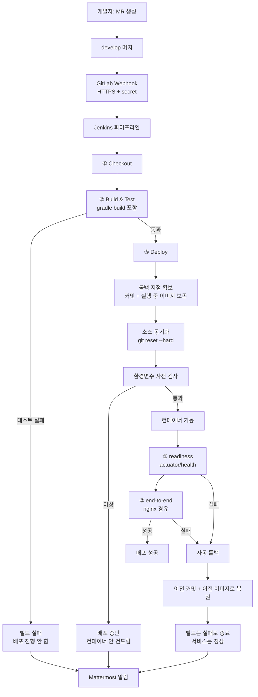

# CI/CD 파이프라인

도담 백엔드의 배포 자동화 구조. 최종 갱신 2026-09-14.

관련 문서: [운영 안내](../README.md) · [보안 방침](../todo/security.md) · [일자별 작업 로그](../todo/jiw/)

---

## 전체 흐름



---

## 단계별 상세

### ① 트리거 — GitLab Webhook

`develop` 브랜치에 머지되면 GitLab이 Jenkins로 webhook을 보낸다.

| 항목 | 값 |
| --- | --- |
| URL | `https://j15d105.p.ssafy.io/jenkins/project/dodam-backend-deploy` |
| 인증 | secret 토큰 (EC2 `~/.jenkins-webhook-secret`) |
| 브랜치 필터 | `develop` |

Jenkins UI 자체는 **외부에서 403으로 차단**되어 있고, 웹훅 수신 경로(`/jenkins/project/`)만 열려 있다.
Jenkins 컨테이너가 `docker.sock` 접근권을 가지므로, 뚫리면 호스트 전체가 넘어가기 때문이다. ([security.md R1](../todo/security.md))

UI는 SSH 터널로만 접근한다.
```bash
ssh -L 8080:127.0.0.1:8080 ssafy-ec2
# 브라우저: http://localhost:8080/jenkins/
```

> ⚠️ **secret이 틀리면 Jenkins는 401만 반환하고 경고 로그를 남기지 않는다.**
> 웹훅은 도착하는데 빌드가 안 걸리면 이걸 먼저 의심할 것.

### ② Build & Test

```bash
docker compose -f "$WORKSPACE/infra/docker-compose.yml" build backend
```

`backend/Dockerfile`의 builder 스테이지가 `./gradlew clean build`를 실행하므로,
**테스트가 깨지면 이미지가 만들어지지 않고 배포 단계로 진행하지 않는다.**

`$WORKSPACE`를 쓰는 이유: 배포 대상 디렉터리(`$APP_DIR`)는 다음 단계에서야 동기화된다.
여기서 `$APP_DIR`을 쓰면 **직전 배포 코드로 테스트**하게 된다.

### ③ Deploy — `infra/scripts/deploy.sh`

| 순서 | 동작 | 목적 |
| --- | --- | --- |
| 1 | 롤백 지점 확보 | 동기화 **전** 커밋 + **실행 중인** backend 컨테이너의 이미지를 `infra-backend:rollback`으로 태그 |
| 2 | 소스 동기화 | `git reset --hard origin/develop` |
| 3 | 환경변수 사전 검사 | `check-env.sh` (아래 참고) |
| 4 | 배포 목록 대조 | compose에 있는데 배포 대상이 아닌 서비스를 WARN |
| 5 | 컨테이너 기동 | `compose up -d --build --no-deps <서비스 목록>` |
| 6 | nginx reload | `conf.d` 변경 반영 |
| 7 | readiness 검사 | `actuator/health` — DB·Redis 포함 |
| 8 | end-to-end 검사 | nginx 경유 `/api/health` |

**이미지까지 보존하는 이유**: 코드만 되돌리고 다시 빌드하면 시간이 걸리고,
**빌드 자체가 깨져 있으면 롤백조차 못 한다.**

> ⚠️ **`infra-backend:latest`를 롤백 지점으로 잡으면 안 된다** (2026-09-14 수정 전까지 그랬다).
> Build & Test 단계가 `deploy.sh`보다 먼저 `compose build backend`를 돌리는데,
> 워크스페이스와 `$APP_DIR`의 compose 프로젝트명이 **둘 다 `infra`**(compose 파일이 있는 디렉터리명)라
> 같은 `infra-backend:latest` 태그를 공유한다. 그래서 `deploy.sh`가 보는 `latest`는 이미
> **방금 빌드한, 아직 검증되지 않은 이미지**였다.
>
> 실측(2026-09-14): `latest`와 `rollback`이 동일 ID(`93a784911df3`)였고,
> 실제 서비스 중인 컨테이너는 별개 이미지(`9ad0e1d19698`)였다.
> → 코드는 롤백돼도 **이미지는 그대로**여서, 앱 자체가 기동을 깨뜨리는 경우 롤백이 무력했다.
>
> 지금은 `docker inspect -f '{{.Image}}' backend`로 **실제 서비스 중인 이미지**를 기준으로 잡는다.
> 더불어 배포가 두 단계 헬스체크를 통과하면 그 이미지에 **`infra-backend:deployed` 고정 태그**를 붙인다.
> 태그가 없는 이미지는 GC 대상이 되어 실제로 사라진 적이 있기 때문이다
> (위 `9ad0e1d19698`이 `docker image inspect`로 조회되지 않았다).
> 실행 중 이미지를 찾지 못하면 이 `deployed` 태그를 fallback으로 쓰고,
> 둘 다 없으면 **WARN을 남기고 코드만 롤백**한다 — 없는 안전망을 있는 척하지 않는다.

---

## 배포 전 검사 — `check-env.sh`

컨테이너를 건드리기 **전에** 잘못된 설정을 걸러낸다.
잘못된 `.env`는 "컨테이너가 죽는다"는 증상으로만 드러나서 원인 추적에 시간이 걸리기 때문이다.

| 검사 | 왜 필요한가 |
| --- | --- |
| 중복 키 | compose는 **마지막 정의**를 쓴다. 앞줄에 값을 채워도 뒷줄 빈 값이 덮어쓴다 |
| 인라인 주석 | `KEY=값 # 설명` 에서 `#` 뒤가 잘려 값이 비는데, 겉보기엔 채워진 것처럼 보인다 |
| **앱↔compose 대조** | `application-prod.yml`이 요구하는 변수를 compose가 전달하는지 확인 |
| 암호화 키 형식 | base64 32바이트인지 (존재 여부만 보면 잘못된 값을 못 거른다) |
| 파일 권한 | 600 권장 |

**앱↔compose 대조가 중요한 이유**: 인프라 파일을 여러 MR이 동시에 건드리면 병합 과정에서
환경변수 줄이 유실된다. 실제로 하루에 두 번 발생해 서비스가 죽었다.
compose만 보는 검사는 "compose가 참조를 잃으면 요구사항도 없다"고 판단해 통과시키므로,
**앱 설정 파일을 별도 출처로 읽어** 대조한다.

---

## 헬스체크가 2단계인 이유

MySQL을 정지시킨 상태에서 실측한 결과:

| 엔드포인트 | 평상시 | DB 정지 시 |
| --- | --- | --- |
| `/actuator/health` | UP | **실패** (DB·Redis 집계) |
| `/api/health` | 200 | **200** (앱 컨트롤러라 의존성을 보지 않음) |

`/api/health`만 확인하면 **DB에 못 붙는 배포가 "성공"으로 통과**한다.
그래서 readiness(actuator)로 의존성까지 확인하고, end-to-end로 nginx 라우팅까지 확인한다.

실패 메시지도 단계별로 구분한다.
- readiness 실패 → "앱이 기동하지 못했거나 DB/Redis에 접속하지 못함"
- end-to-end만 실패 → "라우팅 문제 의심"

컨테이너 자체의 HEALTHCHECK는 `/api/health`를 쓴다.
**DB가 잠깐 끊겼다고 컨테이너를 재시작시키면 안 되기 때문**이다. 재시작해도 DB는 돌아오지 않는다.

---

## 실패 시 — 자동 롤백

```
헬스체크 실패
  → git reset --hard <이전 커밋>       코드 + compose 설정 복원
  → 보존 이미지로 컨테이너 재생성       --build 없이 (빌드가 깨졌어도 롤백 가능해야 함)
  → nginx reload
  → 롤백 후 헬스체크
  → 결과와 무관하게 exit 1
```

**설계 판단: 서비스는 살리되 빌드는 실패로 끝낸다.**
- 서비스가 죽은 채 방치되는 것이 가장 나쁘다
- 그렇다고 롤백 성공을 이유로 빌드를 성공 처리하면 **develop이 깨진 사실을 아무도 모른다**

→ Jenkins는 빨간불, 서비스는 정상.

**한계**
- 롤백은 "직전 배포된 **git 상태**"로 되돌린다. git에 없는 수동 수정은 보존되지 않는다
- 롤백이 develop을 고쳐주지는 않으므로, 원인을 수정하기 전까지 이후 배포도 계속 실패한다

---

## 알림 체계

### 파이프라인 알림 (Jenkins → Mattermost)

| 상황 | 알림 |
| --- | --- |
| 배포 실패 | 🚨 + **서비스 상태 동반 표시** |
| 실패 후 복구 | ✅ |
| 일상적 성공 | **보내지 않음** |

실패 알림에는 서비스 자체의 헬스체크 결과를 함께 조회해 붙인다.
롤백이 동작하면 배포는 실패해도 서비스는 정상이므로 **대응 긴급도가 다르기 때문**이다.
- 🟢 서비스는 정상입니다 (롤백 동작 또는 배포 전 차단)
- 🔴 **서비스도 응답하지 않습니다 — 즉시 확인 필요**

일상적 성공을 알리지 않는 이유: 노이즈가 되면 정작 실패 알림을 읽지 않게 된다.

### 파이프라인 밖 감시

| 경로 | 주기 | 감지 대상 |
| --- | --- | --- |
| Grafana | 1분 평가 | 수집 대상 다운(3분 유예), 디스크 15% 미만, 메모리 10% 미만 |
| cron `container-watch.sh` | 5분 | 컨테이너 정지 / unhealthy / **크래시 루프** |

`container-watch.sh`가 별도로 필요한 이유: Prometheus의 `up` 알림은 **스크레이프 대상만** 본다.
`mysql`, `redis`, `backend`는 수집 대상이 아니므로 그쪽 이상은 잡지 못한다.

> Grafana 알림 채널은 **`slack` 타입**을 쓴다. Mattermost가 Slack 호환 페이로드를 받아주기 때문이다.
> `webhook` 타입은 Grafana 자체 JSON 구조를 보내는데 Mattermost가 400을 반환한다.

---

## 배포 대상 서비스

`deploy.sh`의 `DEPLOY_SERVICES`에 적힌 서비스만 배포가 처리한다.

```
mysql redis backend nginx certbot prometheus node-exporter loki promtail grafana
```

**`jenkins`만 의도적으로 제외한다.** 배포가 Jenkins 컨테이너 **안에서** 실행되므로,
목록에 넣으면 배포 도중 자기 자신을 재시작해 빌드가 죽는다.

jenkins 이미지/설정을 바꿨다면 호스트에서 수동으로:
```bash
cd ~/app/infra && docker compose up -d --build --no-deps jenkins
```

> 목록에 없는 서비스는 배포가 **아예 건드리지 않는다.**
> 설정을 고쳐 머지해도 반영되지 않고, 수동으로 올린 변경은 다음 배포의 `git reset --hard`에
> 밀려 조용히 원복된다.
> 그래서 배포할 때마다 compose 전체 서비스와 대조해 누락을 WARN으로 남긴다.

---

## 운영 시 알아둘 것

### 1. EC2에서 파일을 직접 고치면 다음 배포에 사라진다
`deploy.sh`가 `git reset --hard`로 동기화하기 때문이다.
급하게 서버에서 고쳤다면 **반드시 커밋·머지**해야 유지된다. 이걸 놓쳐 장애가 두 번 재발했다.

### 2. 인프라 파일을 여러 MR이 동시에 건드리면 유실된다
`docker-compose.yml`의 backend 환경변수 블록이 병합 과정에서 세 번 사라졌다.
`check-env.sh`가 배포 전에 잡아주지만, 그건 **이미 머지된 뒤**라 develop은 깨진 상태가 된다.
근본 대책은 "백엔드 MR은 인프라 파일을 직접 수정하지 않고 인프라 담당에게 요청" 하는 팀 합의다.

### 3. 배포 중인 임시 조치
`docker-compose.yml`의 `SPRING_JPA_HIBERNATE_DDL_AUTO: none` 은 **임시**다.
상품 테이블 마이그레이션이 들어오면 제거하고 `validate`로 되돌려야 한다.
현재는 스키마 불일치가 기동 시점에 드러나지 않는 상태다.

---

## 트러블슈팅

| 증상 | 먼저 확인할 것 |
| --- | --- |
| 웹훅은 오는데 빌드가 안 걸림 | secret 불일치 (401만 반환하고 경고 로그 없음), 브랜치 필터 |
| `check-env` 실패로 배포 중단 | 메시지에 어떤 변수가 왜 문제인지 나온다. `.env` 중복 키·인라인 주석 확인 |
| readiness 실패 | 앱 기동 실패 또는 DB/Redis 접속 실패. `docker logs backend` |
| end-to-end만 실패 | nginx 라우팅. `docker exec nginx nginx -t` |
| 배포 실패인데 서비스는 정상 | 롤백이 동작한 것. develop을 고친 뒤 재배포 |
| 설정을 고쳤는데 반영이 안 됨 | 해당 서비스가 `DEPLOY_SERVICES`에 있는지 확인 |

**로그 확인**
```bash
# Jenkins 빌드 로그 (SSH 터널 필요)
ssh -L 8080:127.0.0.1:8080 ssafy-ec2   →   http://localhost:8080/jenkins/

# 컨테이너 로그
ssh ssafy-ec2 'docker logs backend --tail 100'

# Grafana에서 전체 컨테이너 로그 검색
https://j15D105.p.ssafy.io/grafana/  →  도담 폴더  →  로그 대시보드
```
