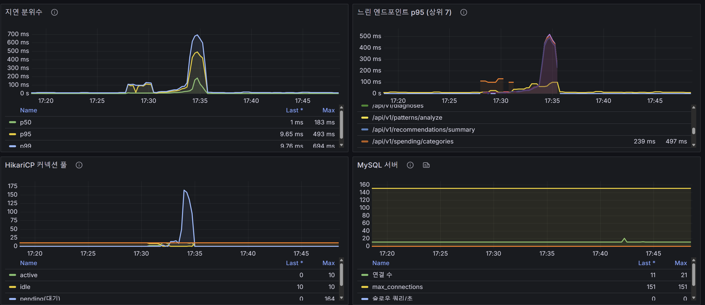
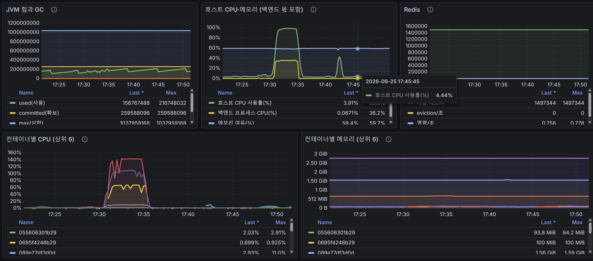

# 부하 테스트 측정 기록 (S15P21D105-693)

측정마다 **값과 배포 커밋을 함께** 남긴다. 어떤 코드에서 난 수치인지 없으면 전후 비교가 성립하지 않는다.
지표 정의·임계는 [monitoring.md](monitoring.md) §3, 측정 절차는 §4.

수집: `python3 infra/scripts/metrics-snapshot.py` (서버에서 실행, Prometheus 컨테이너를 거쳐 질의)

---

## #1 기준선 — 무부하 (2026-09-22 15:50 KST)

배포 커밋 `36d911b` [S15P21D105-670] [FE] Feature: 발견·리포트 그래프와 설명 개선

| 지표 | 값 | 단위 |
| --- | --- | --- |
| 호스트 CPU 사용률 | 5.81 | % |
| 호스트 메모리 여유 | 72.57 | % |
| JVM heap 사용률 | 11.73 | % |
| JVM heap 사용 | 232.2 | MB |
| GC 정지 | 0.0001826 | 초/초 |
| **DB풀 대기(pending)** | **0** | |
| DB풀 active | 0 | |
| **DB풀 max** | **10** | |
| MySQL 슬로우쿼리 | 0 | /초 |
| MySQL threads_connected | 11 | |
| MySQL max_connections | 151 | |
| Redis 메모리 | 1.401 | MB |
| Redis eviction | 0 | /초 |
| HTTP 요청 누적 | 415 | 건 |
| 5xx 오류율 | (0건이라 시리즈 없음) | % |
| 지연 p95 | 0.06044 | 초 |
| 지연 p99 | 0.09205 | 초 |

### 이 수치의 성격

**무부하 상태의 바닥값이다.** 부하를 걸지 않은 상태에서 잰 것이라 "부하 전"이라기보다
**자원 하한선**으로 읽어야 한다. 실제 비교는 부하 중 수치끼리 해야 한다.

HTTP 누적 415건은 배포 직후 헬스체크와 내 확인 호출이 대부분이다.
p95 0.06초·p99 0.09초는 그 조건에서의 응답 시간이라 부하 중 값과 직접 비교하기 어렵다.

### 부하 전에 이미 보이는 것 — `DB풀 max = 10`

HikariCP 기본값이다. MySQL `max_connections`는 151인데 **앱은 10개만 쓴다.**

동시 요청이 10을 넘는 순간부터 초과분은 커넥션을 기다린다(`hikaricp_connections_pending` 상승).
DB 자체는 여유가 있는데 **앱 쪽 풀에서 먼저 막히는** 형태다.

- 부하 테스트에서 `pending`이 오르고 p95가 함께 튀면 원인은 **쿼리가 아니라 풀 크기**다
- 반대로 `pending`이 0인데 느리면 쿼리·인덱스 쪽을 본다
- 이 구분이 "최소 개선"의 방향을 가른다

**지금 풀 크기를 미리 올리지 않는다.** 올려 두면 병목이 어디였는지 증명할 수 없고,
"전후 비교"의 전이 사라진다. 부하로 재현한 뒤에 바꾸고 재측정하는 편이 근거가 남는다.

### 측정에서 고칠 점

5xx가 한 건도 없으면 분자 시리즈가 없어 결과가 **비어 나온다**("데이터 없음").
"오류 없음"과 "측정 실패"가 구분되지 않아 스크립트의 질의를 `or vector(0)`으로 고쳤다.
다음 측정부터는 0%로 나온다.

---

## #2 부하 직전 기준선 (2026-09-23 10:26 KST)

배포 커밋 `3cc955c` [S15P21D105-693] [Infra] docs: 부하 처리 방식 입문용 문서 추가

| 지표 | 값 | 단위 |
| --- | --- | --- |
| 호스트 CPU 사용률 | 4.825 | % |
| 호스트 메모리 여유 | 72.57 | % |
| JVM heap 사용 | 77.28 | MB |
| JVM heap 확보 | 247.6 | MB |
| JVM heap 상한(설정) | 989.9 | MB |
| GC 정지 | 0.0001474 | 초/초 |
| **DB풀 대기(pending)** | **0** | |
| DB풀 active | 0 | |
| **DB풀 max** | **10** | |
| MySQL 슬로우쿼리 | 0 | /초 |
| MySQL threads_connected | 11 | |
| MySQL max_connections | 151 | |
| Redis 메모리 | 1.404 | MB |
| Redis eviction | 0 | /초 |
| HTTP 요청 누적 | 349 | 건 |
| 5xx 오류율 | 0 | % |
| 지연 p95 | 0.04205 | 초 |
| 지연 p99 | 0.08952 | 초 |

**부하 테스트 당일 기준선이다.** #1(09-22, 커밋 `36d911b`)과 배포 버전이 다르므로,
오늘 측정하는 부하 중 수치는 #1이 아니라 **#2와 비교**한다.

### #1에서 고친 것 — 5xx 오류율

#1에서는 "데이터 없음"으로 나왔다. 5xx가 한 건도 없으면 분자 시리즈 자체가 없기 때문이다.
`or vector(0)`을 붙여 이제 **0%**로 나온다. 부하 중에 "오류 없음"과 "측정 실패"가 구분된다.

### #2에서 고친 것 — JVM heap 사용률(%) 제거

#1의 `JVM heap 사용률 11.73% / 232MB`와 오늘 첫 측정 `13.03% / 129MB`가 어긋났다.
MB는 줄었는데 %는 올랐다 — **분모가 움직인다는 뜻이다.**

원인: `sum(jvm_memory_max_bytes{area="heap"})`는 Eden·Survivor·Tenured의 max를 더한 값인데,
**GC가 세대 크기를 런타임에 조정**하면서 합계가 달라진다(`-XX:MaxHeapSize=1g`로 고정인데도).

| | 문제 |
| --- | --- |
| 사용률(%) | 분모가 움직여 **실제 사용량이 늘어도 %가 내려갈 수 있다.** 부하 중에 오해를 만든다 |

→ 사용률을 빼고 **used(사용) / committed(확보) / max(상한)** 세 값을 따로 본다.
Grafana `JVM 힙과 GC` 패널도 같은 방식으로 고쳤다.

지금 값이 그대로 읽힌다: 확보 247MB는 `InitialHeapSize=256m`이고, 상한 990MB는 `MaxHeapSize=1g`다.
**즉 JVM은 아직 힙을 늘리지 않았고 740MB 여유가 있다.** 부하 중 committed가 max로 붙는지 보면 된다.

### 이 상태에서 예상되는 첫 병목

`DB풀 max = 10`(HikariCP 기본값)은 그대로다. 판단 기준은 monitoring.md §3과 같다.

- `pending` 상승 + p95 급등 → **풀 크기**
- `pending` 0인데 느림 → **쿼리·인덱스**
- 호스트 CPU 80% 지속 → **자원 한계**(앱 수정으로 해결 안 됨)

---

## #3 부하 직전 기준선 — 톰캣 스레드 포함 (2026-09-23 13:48 KST)

배포 커밋 `8f52cd0` [S15P21D105-693] [Infra] feat: 톰캣 요청 스레드 지표 수집·패널 추가

**이 판부터 톰캣 스레드가 들어간다.** 부하 중 수치는 #2가 아니라 **#3과 비교**한다.

| 지표 | 값 | 단위 | #2(10:26) 대비 |
| --- | --- | --- | --- |
| 호스트 CPU 사용률 | 3.524 | % | 4.825 → 3.524 |
| 호스트 메모리 여유 | 72.15 | % | 72.57 → 72.15 |
| JVM heap 사용 | 121.1 | MB | 77.28 → 121.1 |
| JVM heap 확보 | 247.6 | MB | 동일 |
| JVM heap 상한(설정) | 989.9 | MB | 동일 |
| GC 정지 | 0 | 초/초 | 0.0001474 → 0 |
| **DB풀 대기(pending)** | **0** | | 동일 |
| DB풀 active | 0 | | 동일 |
| **DB풀 max** | **10** | | 동일 |
| **톰캣 busy 스레드** | **1** | | **신규** |
| **톰캣 스레드 max** | **200** | | **신규** |
| MySQL 슬로우쿼리 | 0 | /초 | 동일 |
| MySQL threads_connected | 11 | | 동일 |
| MySQL max_connections | 151 | | 동일 |
| Redis 메모리 | 1.403 | MB | 1.404 → 1.403 |
| Redis eviction | 0 | /초 | 동일 |
| HTTP 요청 누적 | 81 | 건 | 349 → 81 (재배포로 리셋) |
| 5xx 오류율 | 0 | % | 동일 |
| 지연 p95 | 0.01272 | 초 | 0.04205 → 0.01272 |
| 지연 p99 | 0.01485 | 초 | 0.08952 → 0.01485 |

### 스냅샷에 없지만 함께 떠 둔 값 (MBean 활성화로 새로 열린 것)

| 지표 | 값 | 뜻 |
| --- | --- | --- |
| `tomcat_threads_current_threads` | 10 | 만들어 둔 스레드. 200까지 필요한 만큼 늘어난다 |
| `tomcat_connections_current_connections` | 2 | 맺어 둔 연결 |
| `tomcat_connections_config_max_connections` | **8192** | 연결 상한. **스레드 200과 다른 층이다** |
| `tomcat_global_error_total` | 0 | 톰캣 계층 누적 에러 |
| 톰캣 평균 응답 | **0.007184초** | Spring 필터 **바깥**까지 포함 |
| Spring MVC 평균 응답 | **0.006908초** | 컨트롤러 계층 |

**두 평균의 차이 0.28ms가 지금의 필터·인증·요청 파싱 오버헤드다.**
부하 중 이 차이가 벌어지면 병목이 컨트롤러가 아니라 그 바깥에 있다는 뜻이다.
유휴 상태에서 재어 둔 이 값이 그 판단의 기준선이 된다.

### #2와 수치가 달라진 이유

- **지연 p95가 42ms → 13ms로 내려갔다.** 개선이 아니라 **측정 구간이 다르다.**
  #2는 재배포 직후라 JIT 워밍업·클래스 로딩이 섞인 초기 요청이 평균을 끌어올렸다.
  #3도 재배포 후이지만 누적 81건을 지나며 안정된 구간이다.
  → **두 판 모두 "유휴 기준선"일 뿐 서로의 개선 전후가 아니다.** 비교 대상은 부하 중 수치다.
- **HTTP 요청 누적이 349 → 81로 줄었다.** 카운터는 프로세스가 재시작되면 0부터 다시 센다.
  재배포가 있었으므로 정상이다. 이 값은 절대량이 아니라 **부하 전후 증가분**으로 읽는다.
- **JVM heap 사용이 77MB → 121MB로 늘었다.** GC가 돌기 전 자연 증가분이다.
  `확보(247MB)` 안에 있고 `상한(990MB)`까지 여유가 크다. 부하 중 **확보가 상한에 붙는지**를 본다.

### 이 기준선으로 판정할 것

```
톰캣 busy      1 → 200에 붙나?          붙으면 스레드 포화
DB풀 pending   0 → 오르나?              오르면 풀(10) 병목
두 평균의 차   0.28ms → 벌어지나?       벌어지면 필터·인증 병목
JVM 확보       247MB → 990MB에 붙나?    붙으면 힙 부족
호스트 CPU     3.5% → 80% 넘나?         넘으면 자원 한계(앱 수정 불가)
```

**예상:** 스레드 200보다 DB 풀 10이 훨씬 좁으므로 `busy`가 200에 닿기 전에
`pending`부터 오를 것이다. 이 예상이 빗나가면(pending=0인데 busy만 참)
병목은 DB가 아니라 애플리케이션 처리 자체다.

---

## 병목 예측 — 한계까지 돌리면 어디서 먼저 막히나

부하를 걸기 전에 **각 층의 상한을 실측**해서 계단을 그렸다. 부하 결과를 해석할 때
"예상대로인가, 빗나갔는가"의 기준이 된다.

### 측정된 계단 (2026-09-23)

| 층 | 상한 | 출처 | 여유 |
| --- | --- | --- | --- |
| Nginx (IP당) | **20 r/s** (burst 40) | `default.conf` | 직결 시 해당 없음 |
| 톰캣 커넥션 | 8192 | `tomcat_connections_config_max_connections` | 넉넉 |
| 톰캣 스레드 | 200 | `tomcat_threads_config_max_threads` | 넉넉 |
| **HikariCP** | **10** | `hikaricp_connections_max` | **가장 좁음** |
| MySQL 커넥션 | 151 | `@@max_connections` | 풀이 10이라 도달 불가 |
| MySQL 버퍼풀 | 2048 MB | `@@innodb_buffer_pool_size` | **데이터 329MB → 전부 메모리** |
| JVM 힙 | 1024 MB | `-XX:MaxHeapSize=1g` | 유휴 121MB |
| 호스트 CPU | **4 vCPU** | `nproc` | **14개 컨테이너가 공유** |
| 호스트 메모리 | 15 GB | `free -g` | 여유 11GB |
| 디스크 | 309GB / 29% 사용 | `df -h` | 읽기 전용 테스트라 무관 |

### 중요한 두 가지 사실

**① 디스크는 병목이 아니다.** 전체 데이터 329MB가 버퍼풀 2GB 안에 전부 들어간다.
`transaction` 테이블 271MB(28만 행)가 가장 크지만 그것까지 메모리에 올라간다.
따라서 이 테스트에서 느려진다면 **디스크 I/O가 아니라 CPU나 대기**다.

**② OSIV가 꺼져 있다**(`spring.jpa.open-in-view: false`).
켜져 있었다면 요청 전체(약 32ms) 동안 커넥션을 쥐어 풀 10이 곧바로 치명적이었다.
꺼져 있으므로 **트랜잭션 구간만** 점유하고, 직렬화·응답 쓰기 동안은 커넥션을 돌려준다.
즉 풀 10이 생각보다 덜 조인다.

### 예측 — 순서대로 의심한다

**1순위 · HikariCP 풀(10)**

명시적으로 가장 좁은 문이다. verify 실측 평균 응답 31.78ms 중 DB 트랜잭션 구간을
절반으로 잡으면 `10 / 0.015s ≈ 660 req/s`가 상한이다. 집계 API(`*_summary`)는
쿼리가 여럿이라 더 낮을 수 있다.
→ **징후:** `hikaricp_connections_pending`이 0에서 오르고 `active`가 10에 붙는다.

**2순위 · 호스트 CPU(4 vCPU)**

14개 컨테이너가 CPU 제한 없이 4코어를 자유 경쟁한다(`NanoCpus=0`).
자바 REST+JPA 요청 하나가 CPU 2~5ms를 쓴다고 보면 4코어로 800~2000 req/s인데,
**k6를 같은 호스트에서 돌리면 k6가 그중 상당량을 가져간다.**
→ **징후:** 호스트 CPU가 80%를 넘는데 `pending`은 0이다.

**1순위와 2순위가 비슷한 대역에서 만난다. 어느 쪽이 먼저인지는 재봐야 안다.**

**3순위 · SerialGC**

```
java -XX:MaxHeapSize=1g -XX:InitialHeapSize=256m -jar /app/app.jar
GC: Copy(minor) + MarkSweepCompact(major)  ← SerialGC
```

4코어인데 **단일 스레드 GC**다. 컨테이너 메모리 제한이 1.5GB(=1536MB)로
JVM의 SerialGC 자동 선택 기준(1792MB 미만)에 걸렸기 때문이다.
부하로 할당 속도가 오르면 major GC 한 번에 수백 ms가 멈출 수 있다.
→ **징후:** 평균은 멀쩡한데 **p99만 튄다.** `jvm_gc_pause_seconds`가 계단식으로 오른다.

**의심 대상이 아닌 것:** 톰캣 스레드(200)·커넥션(8192), MySQL 커넥션(151),
디스크, 호스트 메모리. 전부 풀 10보다 한참 넓거나 데이터가 메모리에 다 들어간다.

### 측정을 망칠 수 있는 것 — 결과보다 이쪽이 더 급하다

| 요인 | 무엇이 문제인가 | 대응 |
| --- | --- | --- |
| **k6를 같은 호스트에서 실행** | k6가 4코어 중 1~2개를 가져간다. **백엔드의 한계가 아니라 "k6와 나눠 쓴 뒤 남은 CPU의 한계"를 재게 된다** | `--cpus=1`로 k6를 묶어 영향을 고정하거나, 외부에서 Nginx 경유로 실행(단 20r/s 제한 → `map` 화이트리스트 필요) |
| **Jenkins가 같은 호스트에 있다** | 빌드가 겹치면 CPU·메모리를 크게 먹어 측정이 오염된다. 현재 유휴(CPU 0.2%, 메모리 1.55GB) | 부하 중에는 빌드를 걸지 않는다 |
| 컨테이너 CPU 제한 없음 | 어느 컨테이너가 CPU를 가져갔는지 사후에 구분하기 어렵다 | cAdvisor `컨테이너별 CPU` 패널로 사후 확인 |
| 시연·QA와 시간대 겹침 | 부하 중 화면이 멈춘다 | 실행 시간대 분리(215·317과 합의) |

**k6 동거 문제가 가장 크다.** 4코어짜리 호스트에서 부하 도구와 대상이 같은 CPU를
나눠 쓰면, 측정값은 실제 서버 능력보다 낮게 나오고 **그 차이가 얼마인지도 알 수 없다.**
최소한 `--cpus=1`로 k6를 묶어 두고, 결과에 "k6가 1코어를 점유한 상태의 수치"라고 적는다.

---

## #4 probe 실행 결과 (2026-09-23 14:2x KST) — **병목은 호스트 CPU였다**

배포 커밋 `8f52cd0` · `PROFILE=probe` · 백엔드 직결(`backend:8080`, Nginx 우회) ·
k6는 `--cpus=1`로 제한 · 계정 4개 · THINK_TIME=0 · 4분 20초 완주(abort 없음)

### k6 요약 (클라이언트 관점)

| 항목 | 값 |
| --- | --- |
| 총 요청 | 164,672 |
| **처리량** | **632.1 req/s** |
| 사용자 스토리 완료 | 20,583 (79.0/s) |
| 실패율 | **0.00%** (0 / 164,672) |
| checks | **100.00%** (494,000건 전건 통과) |
| 지연 avg / med | 26.78ms / 17.38ms |
| 지연 p90 / **p95** / p99 | 61.19ms / **84.43ms** / 132.20ms |
| 지연 max | 428.51ms |
| 스토리 소요 p95 | 529.76ms |
| 수신 / 송신 | 222 MB / 52 MB |

**임계(p95<3000, 실패율<5%)를 하나도 넘지 않아 abort 없이 완주했다.**

### 서버 측 (5초 간격 샘플링)

| 지표 | 피크 | 상한 | 포화? |
| --- | --- | --- | --- |
| **호스트 CPU** | **98.5%** | 100% | **■ 포화** |
| **DB풀 active** | **10** | 10 | **■ 포화** |
| **DB풀 pending** | **27** | — | **■ 대기 발생** |
| 톰캣 busy 스레드 | 41 | 200 | □ 20% |
| 톰캣 생성 스레드 | 42 | 200 | □ |
| MySQL threads_running | 5 | 151 | □ **3%** |
| JVM heap | 136 MB | 1024 MB | □ 13% |
| GC 정지 | 0.027 초/초 | — | □ major GC 없음 |

### 컨테이너별 CPU (probe 구간 최대, 코어 단위)

| 컨테이너 | 코어 | 4코어 대비 |
| --- | --- | --- |
| **backend** | **2.165** | **54%** |
| **mysql** | **0.872** | **22%** |
| k6 (부하 도구) | 0.482 | 12% |
| prometheus | 0.104 | 3% |
| 나머지 10개 합 | 0.05 | 1% |
| **합계** | **3.67** | **92%** |

### 판정 — CPU가 원인, DB 풀 대기는 결과다

**근거 ①: 시간 순서.** CPU가 먼저 포화되고 50초 뒤에 pending이 생겼다.

```
t=63   CPU 96%  pending 0   rps 384
t=73   CPU 97%  pending 0   rps 444   ← CPU 포화 시작
t=123  CPU 97%  pending 1   rps 707   ← 50초 뒤에야 대기 발생
t=229  CPU 98%  pending 27  rps 696
```

**근거 ②: MySQL이 놀고 있다.** pending이 27까지 올라 커넥션을 기다리는데
`mysql_threads_running`은 **3~5**다(상한 151). DB 서버는 전혀 힘들지 않다.
즉 커넥션이 부족해서 기다린 것이 아니라, **커넥션을 쥔 스레드가 CPU를 못 얻어서**
반납이 늦어진 것이다.

**근거 ③: 처리량이 평평하다.** VU를 20 → 40으로 두 배 올렸는데 처리량은 그대로다.

```
t=153  VU 20  rps 721   ← 최대
t=214  VU 40  rps 713
t=229  VU 40  rps 696
```

전형적인 포화 곡선이다. 더 밀어도 처리량이 늘지 않고 대기만 길어진다.

### 예측 대비 — 1순위와 2순위가 뒤바뀌었다

| 예측 | 실제 | 판정 |
| --- | --- | --- |
| 1순위 HikariCP(10) | **2차 증상**. active는 10에 붙었으나 MySQL은 여유 | **빗나감** |
| 2순위 호스트 CPU(4코어) | **진짜 병목**. backend 2.17 + mysql 0.87 코어 | **적중(순위만 틀림)** |
| 3순위 SerialGC | 발현 안 함. heap 136MB/1024MB, major GC 0회 | 해당 없음 |
| 톰캣 스레드(200) 여유 | 맞음. 41까지만 사용 | 적중 |
| 디스크 무관 | 맞음. 데이터가 버퍼풀에 전부 적재 | 적중 |

**DB 풀을 키우는 개선은 효과가 없다.** CPU가 이미 98%이므로 커넥션을 더 줘도
그 커넥션을 쓸 CPU가 없다. 오히려 컨텍스트 스위칭이 늘어 악화될 수 있다.

### 알아낸 한계선

- **처리량 한계 ≈ 720 req/s** (4 vCPU, k6가 0.48코어 점유한 상태)
  - k6를 외부로 빼면 약 0.48코어(12%)가 회수되므로 **800 req/s 안팎**이 실제 상한으로 추정된다
- **지연 붕괴점은 아직 못 찾았다.** CPU가 포화됐는데도 p95가 84ms에 머물렀다.
  40 VU로는 큐가 짧아서다. `PROBE_VUS`를 올리면 지연이 무너지는 지점을 볼 수 있다

### 이번 측정의 한계

- **컨테이너별 CPU를 실시간으로 못 봤다.** cAdvisor가 docker.sock 없이 도는 탓에
  `name` 라벨이 없고 `container_id`만 준다. 위 표는 probe가 끝난 뒤
  `container_id`를 살아있는 컨테이너와 대조해 **역산**한 값이다
  (목록에 없는 `941e0f313849`가 사라진 k6 컨테이너)
- k6가 같은 호스트에 있다. 다만 실측 0.482코어로 **예상보다 영향이 작았다**
- 계정 4개에 VU 40이 몰려 한 계정당 10 VU다. 실사용보다 **DB 버퍼풀·캐시 적중이 높다**

---

## #5 probe PROBE_VUS=120 (2026-09-23 15:4x KST) — **지연 붕괴점을 찾았다**

배포 커밋 `8f52cd0` · `PROFILE=probe PROBE_VUS=120` · 백엔드 직결 · k6 `--cpus=1` ·
계단 15 → 30 → 60 → 120 VU · 4분 20초 완주(abort 없음)

### 결과 요약

| 항목 | #4 (40 VU) | **#5 (120 VU)** |
| --- | --- | --- |
| 처리량 | 632 req/s | **631 req/s** (구간 평균) |
| 서버 측 처리량 피크 | 721 req/s | **745 req/s** |
| 지연 p95 | 84ms | **285ms** |
| 스토리 소요 p95 | 530ms | **1.59s** |
| 실패율 | 0.00% | **0.00%** |
| checks | 100% (494,000) | **100% (517,160)** |

**VU를 3배로 올렸는데 처리량은 그대로고 지연만 3.4배가 됐다.**

### 붕괴 지점 (5초 샘플링)

```
t     VU    pending  busy   rps    p95      backend CPU
154   ~45     5       17    745    34ms     1.72
168   ~60     7       20    746    42ms     1.73
184   ~60     6       18    743    48ms     1.24
199   ~60    46       61    746    70ms     1.75     ← 여기까지가 쓸 수 있는 구간
213   120   108      121    733   254ms     1.75     ← 붕괴
244   120   107      119    723   421ms     1.73
258   120    60       74    725   434ms     1.74
```

**처리량 천장은 VU 60에서 이미 닿았다(745 req/s).** 그 뒤로 VU를 두 배 올리자
처리량은 오히려 3% 줄고(746 → 723) **지연만 6배**(70ms → 421ms)가 됐다.
리틀의 법칙 그대로다 — 포화된 계에 부하를 더 넣으면 대기열만 길어진다.

`busy` 스레드는 121까지 올랐다(상한 200). **스레드는 여전히 여유가 있는데**
`pending`이 108이다. DB 커넥션을 기다리는 스레드가 대부분이라는 뜻이고,
그 대기의 원인은 #4에서 확인한 대로 **CPU 포화**다(호스트 96~97.6% 지속).

### 운영 지점 권고

| 부하 | 처리량 | p95 | 판단 |
| --- | --- | --- | --- |
| ~60 VU | **745 req/s** | **70ms** | **쓸 수 있는 최대** |
| 120 VU | 723 req/s | 421ms | 넣어도 얻는 것이 없다 |

### 개선 대상을 찾기 위한 분해

**① 엔드포인트별 — 특정 API가 느린 것이 아니다**

| 엔드포인트 | 평균 | 호출 |
| --- | --- | --- |
| `/api/v1/diagnoses` | 54.70ms | 22,736 |
| `/api/v1/recommendations/summary` | 52.61ms | 22,737 |
| `/api/v1/simulations` | 50.12ms | 22,734 |
| `/api/v1/cards` | 49.01ms | 22,738 |
| `/api/v1/cards/summary` | 47.44ms | 22,737 |
| `/api/v1/loans/summary` | 46.21ms | 22,737 |
| `/api/v1/loans` | 46.01ms | 22,737 |
| `/api/v1/accounts/summary` | 44.94ms | 22,742 |

최고와 최저의 차이가 **22%뿐**이다. 호출 수도 균등하다.
**하나를 골라 최적화해서 얻을 것이 거의 없다.**

**② 계층별 — 필터·인증은 병목이 아니다**

```
톰캣(필터 바깥 포함)   49.08ms
Spring MVC(컨트롤러)   48.89ms
차이                    0.19ms   ← 유휴 기준선(#3)의 0.28ms보다 오히려 작다
```

지연의 **99.6%가 컨트롤러 안**에서 발생한다. JWT 검증·필터 체인·요청 파싱은
부하가 걸려도 비용이 늘지 않았다. 응답 크기도 요청당 **1,052 bytes**로 작아
직렬화·네트워크가 원인일 가능성은 낮다.

**③ 요청당 CPU**

```
backend  1.75 코어 / 745 req/s = 요청당 2.35ms
mysql    0.88 코어 / 745 req/s = 요청당 1.18ms
비율     앱 2 : DB 1
```

### 결론 — 다음 개선은 프로파일링이 선행돼야 한다

지금까지 **아닌 것**은 다 걸러냈다.

| 후보 | 판정 | 근거 |
| --- | --- | --- |
| DB 커넥션 풀 크기 | ✗ | `mysql_threads_running` 2~4 (상한 151) |
| 톰캣 스레드 수 | ✗ | busy 121 / 200 |
| 특정 느린 API | ✗ | 8개가 45~55ms로 균등 |
| 필터·인증·파싱 | ✗ | 계층 차이 0.19ms |
| 응답 크기·직렬화 | ✗ | 요청당 1,052 bytes |
| JVM 힙·GC | ✗ | heap 167MB / 1024MB, major GC 0회 |
| 디스크 I/O | ✗ | 데이터 329MB가 버퍼풀 2GB에 전부 적재 |
| **컨트롤러 내부 CPU** | **○** | 지연의 99.6%, 요청당 2.35ms |

**남은 후보는 컨트롤러 안(쿼리 실행·엔티티→DTO 변환·비즈니스 로직)뿐이다.**
여기서 더 좁히려면 추측이 아니라 **프로파일러(async-profiler / JFR)**가 필요하다.
"어느 메서드가 CPU를 쓰는가"는 지금 있는 지표로는 답할 수 없다.

### #5 Grafana 화면 판독 (15:25~15:55 구간 캡처)

샘플러·k6 숫자와 별도로 대시보드 화면을 남겼다. 그래프에서만 보이는 것이 있다.

| 패널 | 읽은 값 | 판단 |
| --- | --- | --- |
| 톰캣 요청 스레드 | busy **121** / current **122** / max 200 | 상한의 61%. **스레드는 끝까지 여유** |
| 지연 분위수 | p50 **135ms** / p95 **523ms** / p99 **575ms** | p50과 p99의 차가 4배 — 일부 요청만 오래 기다린다 |
| 느린 엔드포인트 p95 | **`/actuator/health` 610ms** · `/actuator/prometheus` 175ms · `/api/health` 2.74ms | 아래 별도 항목 |
| HikariCP | pending **108** / active 10 / idle 10 | active가 max(10)에 붙고 pending이 치솟는 전형적 포화 |
| MySQL 서버 | 연결 **21** / 151 · 슬로우 쿼리 **0** | **DB는 끝까지 한가했다** |
| JVM 힙과 GC | used **178MB** / committed 260MB / max 1038MB | 상한의 17%. GC는 문제가 아니었다 |
| 호스트 CPU | **97.6%** · 백엔드 프로세스 74.6% · 메모리 여유 70.9% | CPU만 포화, 메모리는 여유 |
| Redis | 메모리 1.4MB 평평 · eviction 0 · **명령 0.76~0.96/초** | 아래 별도 항목 |
| 컨테이너별 CPU | 최대 **187%**(1.87코어) | backend |
| 컨테이너별 메모리 | jenkins **1.56~1.60GB**가 최대 | 부하와 무관하나 호스트 메모리를 상시 점유 |

**그래프에 봉우리가 두 개다.** 15:39의 작은 봉우리는 임계 파싱을 확인하려고 돌린
25초짜리 실행 두 번이고, 15:44~45의 큰 봉우리가 `#5` 본 실행이다.

#### 새로 드러난 것 ① `/actuator/health`가 부하 중 610ms

다른 엔드포인트가 45~55ms일 때 이것만 610ms다. `/actuator/health`는
**DB·Redis health indicator를 실제로 호출**하므로, 커넥션 풀이 포화되면
그 대기 시간이 그대로 얹힌다.

**재시작 위험은 없다.** 컨테이너 `HEALTHCHECK`는 `/api/health`를 쓰고
(`Dockerfile`: `curl -fsS http://localhost:8080/api/health`, timeout 5s, retries 5),
그 경로는 부하 중에도 **2.74ms**였다. DB를 건드리지 않기 때문이다.

다만 `/actuator/health`를 기동 확인이나 외부 감시에 쓰는 쪽이 있다면
**부하 중 timeout으로 오탐이 날 수 있다.** 지금 그렇게 쓰는 곳은 없다.

#### 새로 드러난 것 ② Redis가 거의 쓰이지 않는다

부하 중에도 **초당 0.76~0.96 명령**, 메모리 1.4MB에서 완전히 평평하다.
즉 이번 부하 경로(계좌·카드·대출·진단·추천·시뮬레이션 조회)에는 **캐시가 전혀 걸려 있지 않다.**
현재 Redis는 AI 코치 응답 캐시에만 쓰인다.

병목이 컨트롤러 내부 CPU인 상황에서 **같은 응답을 반복 계산하고 있다면**
캐시는 직접적인 해법이 된다. 다만 "반복 계산인지"는 프로파일링으로 확인해야 한다 —
계정 4개에 VU 120이 몰린 이번 부하는 실사용보다 반복이 훨씬 많으므로,
**캐시 효과가 과대평가되기 쉽다**는 점도 함께 봐야 한다.

#### 확인하지 못한 것 — 15:28~15:38 구간의 호스트 CPU 40~80%

부하가 없는 시간대인데 호스트 CPU가 40~80%로 출렁인다. 그런데
**컨테이너별 CPU 패널은 같은 구간에서 거의 바닥**이다. 컨테이너 밖 프로세스가
CPU를 썼다는 뜻인데(dockerd·containerd·ssh 세션 등), 정확한 출처는 확인하지 못했다.

실행 직전 확인한 유휴 CPU는 3.31%였고 부하 구간은 명확히 분리되므로
`#5` 결과 자체는 유효하다. 다만 **"유휴=3%"가 항상 참은 아니다**는 것을 알게 됐고,
다음 측정에서는 시작 직전 유휴값을 매번 기록에 남긴다.

---

## #6 JFR 프로파일링 (2026-09-24 07:02~07:17 UTC) — **CPU를 쓰는 곳을 찾았다**

배포 커밋 서버 HEAD `f31b20f` · JFR `settings=profile duration=15m` ·
`PROFILE=probe PROBE_VUS=120` · 시작 직전 유휴 CPU **7.88%** ·
k6 `--cpus=1` · 기록 파일 39MB · **ExecutionSample 18,200개**

### 부하 자체는 #5를 재현했다

| | #5 (JFR 없음) | #6 (JFR 켬) |
| --- | --- | --- |
| 처리량 | 631 req/s | **563 req/s** |
| 서버 측 피크 | 745 req/s | **700 req/s** |
| 지연 p95 | 285ms | **336ms** |
| pending 피크 | 108 | **108** |
| busy 피크 | 121 | **121** |
| 실패율 | 0.00% | **0.00%** |

JFR 오버헤드로 처리량이 약 6% 낮다. **이 수치는 개선 전후 비교의 "전"으로 쓰지 않는다.**

### 엔드포인트별 지연 (probe 임계 복구 효과)

| 엔드포인트 | avg | p95 |
| --- | --- | --- |
| `diagnoses` | 69.85ms | 341.43ms |
| `recommendation_summary` | 68.39ms | 348.62ms |
| `simulations` | 65.52ms | 338.20ms |
| `cards` | 61.88ms | 330.74ms |
| `card_summary` | 60.99ms | 337.66ms |
| `loan_summary` | 59.83ms | 332.66ms |
| `loans` | 59.55ms | 326.91ms |
| `account_summary` | 58.99ms | 335.13ms |

**p95는 8개가 327~349ms로 거의 동일하다.** 부하가 걸리면 개별 API 특성보다
공통 대기(CPU 경합)가 지배한다는 뜻이다.

### CPU를 태운 계층 (최상단 프레임 기준, 18,200 샘플)

| 계층 | 비중 |
| --- | --- |
| JDK 기본 (HashMap·String·ConcurrentHashMap 등) | 42.3% |
| Spring(기타) | 13.0% |
| **MySQL 드라이버** | **10.2%** |
| Hibernate/JPA | 8.8% |
| Jackson(JSON 직렬화) | 8.6% |
| **Micrometer/Observation** | **5.6%** |
| Tomcat | 5.0% |
| 기타 | 3.4% |
| Spring Security | 1.7% |
| Logback | 1.2% |
| **우리 코드(`com.ssafy.dodam`)** | **0.4%** |

> **우리 코드가 최상단인 샘플은 0.4%뿐이다.** 비즈니스 로직 자체는 CPU를 거의 쓰지 않고,
> **프레임워크 계층이 대부분을 쓴다.** 도메인 로직을 손봐서 얻을 것이 거의 없다는 뜻이다.

스레드별로는 **97.2%가 `http-nio-8080-exec-*`** — 요청 처리 스레드가 CPU를 다 쓴다.
배치·스케줄러 같은 백그라운드 작업은 무관하다.

### 개선 후보 ① MySQL 드라이버의 SQL 문자열 파싱 (10.2%)

최상단 프레임 상위에 드라이버의 문자열 스캔이 반복해서 나온다.

```
4.1%  com.mysql.cj.util.StringInspector.indexOfNextChar
1.1%  com.mysql.cj.util.StringUtils.regionMatchesIgnoreCase
0.9%  com.mysql.cj.util.StringInspector.indexOfNextValidIdentifierChar
```

**PreparedStatement를 매 실행마다 다시 파싱하고 있다는 신호다.** 현재 JDBC URL에
캐시 옵션이 하나도 없다.

```
jdbc:mysql://mysql:3306/<db>?useSSL=false&allowPublicKeyRetrieval=true
  &serverTimezone=Asia/Seoul&characterEncoding=UTF-8
```

`cachePrepStmts`는 기본값이 **false**다. HikariCP가 권장하는 조합을 붙이면
같은 SQL의 재파싱을 줄일 수 있다.

```
cachePrepStmts=true&prepStmtCacheSize=250&prepStmtCacheSqlLimit=2048&useServerPrepStmts=true
```

**설정만 바꾸면 되고 효과를 전후 비교로 잴 수 있다.** 개선 1순위로 삼는다.

### 개선 후보 ② Spring Security Observation (약 2.6%)

Micrometer 5.6% 중 **46.5%가 Spring Security의 필터 체인 관측**이었다.

```
37.5%  ObservationFilterChainDecorator$ObservationFilter.wrapFilter
 4.9%  ObservationFilterChainDecorator$...$ObservationReference.start
 4.1%  ObservationFilterChainDecorator$FilterChainObservationConvention.getLowCardinalityKeyValues
```

Spring Security 6은 필터마다 Observation을 만든다. 우리는 이 지표를 쓰지 않는다
(대시보드에 Security 필터 지표가 없다). 끄면 약 2.6%를 회수한다.

### 내가 틀린 것 — #5의 "필터·인증은 병목이 아니다"는 근거가 틀렸다

`#5`에서 톰캣 평균(49.08ms)과 Spring MVC 평균(48.89ms)의 차가 0.19ms인 것을 보고
**"필터·인증·파싱은 비용이 없다"**고 적었다. 결론의 방향은 맞았지만 근거가 틀렸다.

Spring Boot의 `WebMvcMetricsFilter`는 필터 체인의 **가장 바깥쪽**에 등록된다.
즉 `http_server_requests_seconds`는 **Security 필터를 포함한 시간**을 잰다.
따라서 톰캣과의 차 0.19ms는 "Security 필터 비용"이 아니라
**톰캣 커넥터와 메트릭 필터 사이**만 잰 값이었다. 처음부터 Security 필터를 볼 수 없는 지표였다.

실제로는 Security 필터 체인이 **약 4.3%**(Security 1.7% + 그 안의 Observation 2.6%)를 쓴다.
0은 아니다. **지표로 "없다"를 증명했다고 생각한 것이 잘못이었고, 프로파일러가 필요했던 이유다.**

한편 JWT 인증 자체는 실제로 가벼웠다. `JwtAuthenticationFilter.doFilterInternal`이
우리 코드 중 1위(14.3%)로 보였지만, **그 샘플의 98.3%가 `filterChain.doFilter()` 하위**였다.
필터 자신의 일(`parseAccessToken` 등)은 약 4.6%다.
**"우리 코드 중 가장 안쪽 프레임"만 세면 체인의 바깥 필터가 과대평가된다**는 함정이다.

### 곁다리 — `jfr` 도구가 원본을 덮어썼다

`docker compose exec backend jfr summary /tmp/load.jfr`을 돌렸더니
`file is empty`가 나왔다. **`jfr` 도구도 JVM이라 `JAVA_TOOL_OPTIONS`를 물려받아
`-XX:StartFlightRecording=...filename=/tmp/load.jfr`로 새 기록을 시작하며 원본을 비웠다.**

호스트에 `docker cp`로 사본을 먼저 떠 둔 덕에 39MB를 잃지 않았다.
분석은 `-e JAVA_TOOL_OPTIONS=`로 비워서 실행해야 한다. `profiling.md`에 반영했다.

---

## #7 개선 ① PreparedStatement 캐시 적용 후 (2026-09-24 07:26 UTC) — **첫 전후 쌍**

변경: `DB_URL`에 `cachePrepStmts=true&prepStmtCacheSize=250&prepStmtCacheSqlLimit=2048&useServerPrepStmts=true`
(커밋 `36a54b2`) · 그 외 조건은 `#5`와 동일(JFR 없음, `PROFILE=probe PROBE_VUS=120`, k6 `--cpus=1`)

### 전후 비교 — 기준선은 `#5`

| 지표 | #5 (캐시 없음) | **#7 (캐시 있음)** | 변화 |
| --- | --- | --- | --- |
| k6 처리량 | 631 req/s | **667 req/s** | **+5.7%** |
| 서버 측 피크 처리량 | 745 req/s | **778 req/s** | **+4.4%** |
| k6 지연 p95 | 285.3ms | **275.98ms** | **-3.3%** |
| k6 지연 avg | — | 53.03ms | — |
| 스토리 소요 p95 | 2.01s | **1.59s** | **-21%** |
| 총 요청 | 146,784 | **174,144** | +18.6% |
| 실패율 | 0.00% | **0.00%** | 동일 |
| busy 스레드 피크 | 121 | 121 | 동일 |
| 호스트 CPU | 97~98.5% | 97~98.4% | 동일 |

### 가장 뚜렷한 차이 — 60 VU 구간에서 `pending`이 0을 유지한다

```
#5   t=153 rps 745 pending  2 | t=184 rps 743 pending  6 | t=198 rps 686 pending 29
#7   t=123 rps 775 pending  0 | t=154 rps 757 pending  0 | t=199 rps 779 pending  2
```

같은 60 VU에서 **#5는 커넥션 대기가 생기기 시작했지만 #7은 0을 유지**하면서
처리량도 743 → 775 수준으로 높다. 서버 측 p95도 같은 구간에서
#5 34~70ms → **#7 18~47ms**로 낮아졌다.

120 VU로 올리면 둘 다 무너지는 것은 같다(pending 108~112, p95 400ms대).
**병목이 CPU라는 사실은 그대로이고, 그 CPU를 조금 덜 쓰게 된 것이다.**

### 기대보다 효과가 작다 — 정직하게

프로파일에서 MySQL 드라이버가 **10.2%**였으므로 그만큼의 개선을 기대했으나
실제는 **4~6%**다. 가능한 이유:

- 드라이버 10.2% 전부가 PreparedStatement 재파싱은 아니다(결과 집합 처리·문자열 인코딩 포함)
- `useServerPrepStmts=true`는 파싱을 줄이는 대신 **서버 사이드 prepare 왕복**을 추가한다
- CPU가 여전히 98%이므로 **병목 자체는 그대로**다. 총량이 줄어 같은 CPU로 조금 더 처리할 뿐이다

확인하려면 JFR을 다시 떠서 드라이버 비중이 실제로 줄었는지 봐야 한다(미실시).

### 이번 측정의 조건 차이 — 시작 유휴 CPU가 높았다

| | 시작 직전 CPU |
| --- | --- |
| #6 | 7.88% |
| **#7** | **37.19%** |

컨테이너를 재생성한 직후라 워밍업이 `rate[1m]` 창에 남아 있었다.
**#7은 불리한 조건에서 측정됐고, 그럼에도 #5보다 나은 수치가 나왔다.**
즉 위 개선폭은 과소평가일 가능성이 있다.

### 대시보드 화면 (16:25~16:30 구간)

| 패널 | 값 |
| --- | --- |
| 처리량 | **757 req/s** |
| 지연 p95 | 304ms |
| DB풀 대기 | 109 |
| 5xx 오류율 | **0%** |
| 수집 대상 정상 | 1 |

지연 분위수 패널의 최대값(p50 183ms / p95 569ms / p99 772ms)은
**16:05~16:10의 `#6`(JFR 켜짐) 구간**이 포함된 값이다. `#7` 구간만 보면 더 낮다.

---

## #8 개선 ② Spring Security Observation 비활성화 (2026-09-24 07:43 UTC)

변경: `MANAGEMENT_OBSERVATIONS_ENABLE_SPRING_SECURITY=false` (커밋 `aa00ced`) ·
개선 ①은 유지 · 그 외 조건 `#5`와 동일 · **시작 직전 유휴 CPU 5.77%**

**검증:** 적용 후 `/actuator/prometheus`에서 `spring_security*` 지표 줄 수 **0**
(적용 전에는 `spring_security_filterchains_*`, `spring_security_authorizations_*` 존재).

### 누적 전후 비교

| 지표 | #5 (개선 전) | #7 (①만) | **#8 (①+②)** | 누적 변화 |
| --- | --- | --- | --- | --- |
| k6 처리량 | 631 req/s | 667 req/s | **690 req/s** | **+9.4%** |
| **서버 측 피크 처리량** | 745 req/s | 778 req/s | **831 req/s** | **+11.5%** |
| k6 지연 avg | — | 53.03ms | **51.30ms** | — |
| k6 지연 p95 | 285.3ms | 275.98ms | **266.07ms** | **-6.7%** |
| k6 지연 p99 | — | 439.92ms | **410.96ms** | — |
| 스토리 소요 p95 | 2.01s | 1.59s | **1.47s** | **-27%** |
| 총 요청 | 146,784 | 174,144 | **180,080** | +22.7% |
| 실패율 | 0.00% | 0.00% | **0.00%** | 동일 |
| checks | 전건 통과 | 전건 통과 | **540,224건 전건 통과** | — |

### 120 VU 구간에서도 처리량이 유지된다

```
#7   t=214 rps 757  | t=244 rps 727  | t=259 rps 738
#8   t=224 rps 816  | t=244 rps 803  | t=263 rps 791
```

무너진 뒤에도 **#8이 약 70 req/s 높다.** 포화 상태에서 요청당 CPU가 줄어든 효과가
그대로 남는다.

### 측정 조건 차이 — `#7 → #8` 단독 비교는 조심해야 한다

| | 시작 직전 유휴 CPU |
| --- | --- |
| #7 | **37.19%** (재생성 직후 워밍업이 rate 창에 남음) |
| #8 | **5.77%** (안정화 대기 후) |

`#8`이 더 유리한 조건에서 측정됐다. 따라서 **②만의 효과 +3.4%는 과대평가일 수 있다**
(프로파일 기준 기대치는 약 2.6%였다). 반면 `#5 → #8` 누적 +9.4%는
`#5`도 정상 조건이었으므로 신뢰할 수 있다.

`#8`부터는 안정화 조건(`CPU<10%` **그리고** 고부하 프로세스 없음)을 자동으로 기다린 뒤
측정을 시작하도록 절차를 바꿨다.

### 남은 한계 — 병목은 여전히 호스트 CPU다

```
t=103  CPU 96.5%  rps 816  pending   0   backend 1.16코어
t=224  CPU 98.0%  rps 816  pending  95   backend 1.71코어
```

개선 두 건은 **요청당 CPU를 줄였을 뿐 병목의 위치를 바꾸지 못했다.**
호스트 CPU는 여전히 97~98%에서 포화하고, 120 VU에서는 `pending`이 100을 넘는다.
여기서 더 나아가려면 **스케일 업(4 → 8 vCPU)이나 응답 캐싱** 같은 구조 변경이 필요하다.

---

## 측정 조건 — 데이터 크기 (시드 변경 시 반드시 확인)

`#1`~`#8`의 모든 수치는 **아래 데이터 상태에서 잰 값**이다.
시드가 바뀌면 절대값은 그대로 쓸 수 없다.

| 항목 | `#1`~`#8` 측정 당시 (2026-09-24 오전) | **현재 (2026-09-24 18:00 재적재 후)** |
| --- | --- | --- |
| 전체 DB | 330 MB | **932 MB** |
| `transaction` | 271 MB · 348,794행 | **892 MB · 1,394,125행** |
| 거래 기간 | 2026-03-01 ~ 2026-09-27 (6개월) | **2024-09-01 ~ 2026-09-27 (24개월 + 시연 9월)** |
| MySQL 버퍼풀 | 2,048 MB | 2,048 MB |
| **데이터/버퍼풀** | 16% | **46%** — 여전히 전부 메모리에 적재 |

**`#1`~`#8`의 수치는 왼쪽 열 상태에서 잰 값이다.** 오른쪽 열이 현재 서버 상태이므로,
다음 측정은 `#8`과 직접 비교하지 말고 새 기준선부터 다시 잡는다(아래 "시드 변경 후 해야 할 일").

### 시드가 바뀌면 무엇이 무효가 되나

| 항목 | 영향 | 이유 |
| --- | --- | --- |
| **개선 ① PreparedStatement 캐시** | **유효** | SQL 문자열 파싱 비용을 줄이는 것이라 행 수와 무관하다 |
| **개선 ② Observation 비활성화** | **유효** | 필터 체인 오버헤드라 DB와 완전히 무관하다 |
| 처리량·지연 **절대값** | **무효** | 쿼리가 처리하는 행 수가 달라진다 |
| 병목 판정(호스트 CPU) | **재확인 필요** | 아래 참조 |
| 디스크가 병목이 아니라는 판단 | **재확인 필요** | 데이터가 버퍼풀을 넘으면 뒤집힌다 |

### 24개월 확장(S15P21D105-706) — 예상 대 실측

재적재를 마치고(2026-09-24 17:52) 실측했다. 행 수는 거의 맞혔고 **크기는 예상보다 작다.**

| | 예상 | 실측 | |
| --- | --- | --- | --- |
| `transaction` 행 | 약 1,395,000 | **1,394,125** | 오차 0.1% |
| `transaction` 크기 | 약 1,080 MB | **892 MB** | 예상의 83% |
| 전체 DB | 약 1,140 MB | **932 MB** | 예상의 82% |
| 버퍼풀 대비 | 약 56% | **46%** | |

**예상이 큰 쪽으로 빗나간 이유:** 6개월치 271MB를 4배 해서 추정했는데, 그 271MB에는
**행 수에 비례하지 않는 인덱스·페이지 여유분**이 섞여 있었다. 행당 비용으로 보면
재적재 전 815B/행 → 후 671B/행이다. 테이블을 새로 채우면 페이지가 조밀하게 차서
(기존 테이블은 반복 적재로 단편화돼 있었다) 행당 크기가 줄어든 것으로 본다.
**다음에 크기를 추정할 때는 "현재 크기 × 배수"가 아니라 "행당 크기 × 새 행 수"로 잡고,
기존 테이블이 단편화돼 있으면 과대 추정된다는 점을 감안한다.**

**결론은 바뀌지 않는다 — 버퍼풀(2GB) 안에 들어간다**(46%, 예상 56%보다 여유 있다).
디스크 I/O가 새 병목이 될 가능성은 낮고 **병목은 여전히 호스트 CPU일 것으로 예상된다.**
다만 쿼리당 처리 행이 늘어 **처리량은 떨어질 것**이다(얼마나인지는 재측정해야 안다).

여유가 16% → 46%로 줄어든 점은 기록해 둔다. 여기서 한 번 더 확장하면
버퍼풀을 넘어 **성격이 다른 병목(디스크)**으로 바뀐다.

### 시드 변경 후 해야 할 일

1. 적재가 끝난 뒤 **CPU가 안정될 때까지 대기**(적재 자체가 CPU·I/O를 크게 쓴다)
2. 위 표를 새 값으로 갱신
3. `probe PROBE_VUS=120`으로 **새 기준선 1판**(약 10분: 안정화 + 4분 20초)
4. 이후 개선 비교는 그 새 기준선과 한다

**2026-09-24 재적재 진행 상태: 1·2 완료, 3(새 기준선) 아직.**
`#8` 이후의 모든 비교는 새 기준선을 받은 다음에 한다. 적재 절차와 그때 걸린 문제는
`infra/todo/jiw/day-13.md` 2026-09-24 절, 재적재 스크립트는 `infra/scripts/seed-load.sh`에 있다.

> 브리프의 "DB 적재와 실행 시간대를 분리한다"가 정확히 이 이유다.
> 적재 중에 측정하면 적재 부하가 섞이고, 적재 전후를 섞어 비교하면 개선 효과를 오판한다.

---

## #9 24개월 시드 적재 후 새 기준선 (2026-09-25 07:38 UTC)

데이터: **transaction 1,394,125행 · 전체 928.3MB · 24개월**(2024-09-01~2026-09-27) ·
개선 ①②  적용 상태 · `PROFILE=probe PROBE_VUS=120` · **시작 직전 유휴 CPU 4.52%**

### 데이터가 4배인데 성능이 거의 그대로다

| 지표 | #8 (6개월) | **#9 (24개월)** | 변화 |
| --- | --- | --- | --- |
| transaction 행 수 | 348,794 | **1,394,125** | **4.0배** |
| 전체 DB | 330 MB | **928.3 MB** | 2.8배 |
| 버퍼풀 대비 | 16% | **45.3%** | — |
| k6 처리량 | 690 req/s | **703.6 req/s** | **+2.0%** |
| 서버 측 피크 | 831 req/s | 781.6 req/s | -5.9% |
| 지연 p95 | 266.07ms | **271.47ms** | +2.0% |
| 지연 avg | 51.30ms | **50.35ms** | -1.9% |
| 스토리 소요 p95 | 1.47s | **1.52s** | +3.4% |
| 실패율 | 0.00% | **0.00%** | 동일 |
| checks | 540,224 전건 통과 | **549,752 전건 통과** | — |

**데이터가 4배가 됐는데 처리량·지연이 측정 오차 수준(±2%)에서 동일하다.**

### 왜 영향이 없었나 — 부하 경로가 `transaction`을 읽지 않는다

엔드포인트별 평균을 `#7`(6개월)과 비교하면 거의 변화가 없다.

| 엔드포인트 | #7 (6개월) | #9 (24개월) | 변화 |
| --- | --- | --- | --- |
| `account_summary` | 49.42ms | 47.36ms | -4% |
| `cards` | 53.12ms | 49.55ms | -7% |
| `card_summary` | 51.20ms | 47.58ms | -7% |
| `loans` | 51.06ms | 47.00ms | -8% |
| `loan_summary` | 49.72ms | 47.75ms | -4% |
| `simulations` | 54.59ms | 49.65ms | -9% |
| `recommendation_summary` | 56.29ms | 53.13ms | -6% |
| **`diagnoses`** | 58.85ms | **60.82ms** | **+3%** |

`diagnoses`만 소폭 늘었고 나머지는 오히려 줄었다(개선 ②가 `#7`에는 없었던 영향).

이 8개 API는 **`account`·`card`·`loan`·`diagnosis`·`recommendation`·`simulation`
테이블과 사전 계산된 파생 데이터를 읽는다.** 1,394,125행짜리 `transaction`을
직접 스캔하는 쿼리가 없어서 데이터 증가가 비용으로 이어지지 않았다.

### 이번 판으로 드러난 부하 시나리오의 한계

**거래 조회·집계 API가 시나리오에 하나도 없다.** 서버 지표에는 존재하지만
k6가 호출하지 않는 경로들이다(평균 지연은 부하 중 측정된 값).

```
/api/v1/recommendations              286.79ms
/api/v1/diagnoses/latest             240.29ms
/api/v1/users/me                     232.31ms
/api/v1/accounts                     170.58ms
/api/v1/goals                        168.61ms
/api/v1/cashflow/events              138.13ms
/api/v1/spending/monthly-summary     108.94ms
/api/v1/transactions                  99.79ms
```

**24개월 데이터의 진짜 영향은 이쪽에서 나타난다.** 특히
`/api/v1/transactions`(목록·페이징)와 `/api/v1/spending/monthly-summary`(기간 집계)는
행 수에 직접 비례한다. 지금 시나리오로는 **"데이터가 늘어도 괜찮다"고 말할 수 없고,
"우리가 재는 8개 경로는 데이터 증가에 둔감하다"까지만 말할 수 있다.**

### 결론 — 이 판을 새 기준선으로 쓴다

- 개선 ①② 효과는 24개월 데이터에서도 유지된다
- 병목은 여전히 **호스트 CPU**(97~98% 포화, pending 108, busy 120)
- 디스크는 예상대로 병목이 아니다(928MB < 버퍼풀 2,048MB)
- **잔여 한계:** 거래 조회·집계 경로 미측정

---

## #10 `load` 22분 지속 테스트 (2026-09-25 07:52~08:13 UTC) — **누수 없음 · 전 항목 합격**

데이터 24개월(139만 행) · 개선 ①② 적용 · `PROFILE=load LOAD_VUS=50 THINK_TIME=0` ·
k6 `--cpus=1` · 시작 직전 CPU 2.3% · 백엔드 기동 후 16시간 경과

### 결과 — 100만 요청, 오류 0

| 지표 | 값 | 임계 | 판정 |
| --- | --- | --- | --- |
| 총 요청 | **1,003,064** | — | — |
| **처리량(22분 평균)** | **795.8 req/s** | — | — |
| checks | **3,009,176건 전건 통과** | rate>0.99 | **✓ 100.00%** |
| 실패율 | **0.00%** | rate<0.01 | **✓** |
| 스토리 실패율 | **0.00%** (125,382건) | rate<0.01 | **✓** |
| 지연 p95 | **128.59ms** | p95<800 | **✓** |
| 지연 p99 | **185.11ms** | p99<1500 | **✓** |
| 스토리 소요 p95 | 722ms | — | — |

**엔드포인트별 임계 8개도 전부 통과했다.**

```
account_summary 121.87ms(<500) · cards 126.68ms(<500) · loans 122.52ms(<500)
card_summary 125.29ms(<700) · loan_summary 122.02ms(<700) · diagnoses 147.33ms(<700)
recommendation_summary 131.47ms(<700) · simulations 127.31ms(<700)
```

> `load`는 **합격/불합격 판정용** 프로필이다. 이번 실행은 **전 항목 합격**이다.

### 누수 판정 — 없음

| 지표 | 시작(07:51) | 종료(08:13) | 판정 |
| --- | --- | --- | --- |
| **JVM heap 사용** | 152.37 MB | **142.96 MB** | **✓ 오히려 감소** |
| **HikariCP active** | 0 | **0** | **✓ 전부 반납** |
| **HikariCP idle** | 10 | **10** | **✓ 풀 정상** |
| 톰캣 생성 스레드 | 10 | 52 | 정상 — 아래 참조 |
| JVM 전체 스레드 | 35 | 77 | 정상 — 아래 참조 |

**heap은 22분 내내 107~221MB 사이에서 등락했고 상승 추세가 없다.**
GC가 정상적으로 회수하고 있으며 메모리 누수는 관찰되지 않았다.

**커넥션은 완전히 반납됐다.** 22분 동안 `pending`이 13~38로 꾸준히 있었는데도
종료 시점에 `active=0`, `idle=10`으로 초기 상태와 같다. 커넥션 누수 없음.

**스레드 증가(10→52, 35→77)는 누수가 아니다.** 톰캣은 부하에 맞춰 스레드를 만들고
바로 줄이지 않는다(유휴 스레드 정리는 기본 60초 후). 측정이 종료 직후라 아직 유지 중이며,
상한(200)에 한참 못 미친다.

### 처리량이 probe보다 높다 — 이유

| 프로필 | 처리량 |
| --- | --- |
| `#9` probe (120 VU까지, 4분 20초) | 703.6 req/s |
| **`#10` load (50 VU, 22분)** | **795.8 req/s** |

두 가지가 겹쳤다.

1. **probe는 포화 구간(120 VU)이 평균을 깎는다.** 한계를 넘긴 구간이 절반이다.
2. **JIT 워밍업.** 샘플러 복구 직후(부하 10분 경과) 순간 처리량이 **914.9 req/s**까지
   올랐다. 22분을 돌리면 핫스팟이 충분히 컴파일돼 짧은 실행보다 빨라진다.

> **짧은 probe는 JIT가 덜 데워진 상태를 잰다.** probe는 병목 위치를 빨리 찾는 용도이고,
> **지속 가능한 처리량의 대표값은 `load` 쪽(795.8 req/s)이 더 정확하다.**

### 이번 실행의 실수 — 샘플러를 잘못된 디렉터리에서 띄웠다

`sampler.py`는 `docker compose exec`를 쓰므로 **compose 파일이 있는 `infra/`에서
실행해야 하는데 `/home/ubuntu/app`에서 띄웠다.** 모든 값이 `-`로 찍혔다.

부하 10분이 지나서야 알아차리고 샘플러만 다시 붙였다.
**부하 자체는 정상이었고, 누수 관찰에 중요한 후반부(44~50 VU 구간)는 확보**했으며
시작 시점 지표는 부하 전에 따로 찍어 둔 것이 있어 전후 비교가 가능했다.

→ 앞으로 백그라운드 작업은 **시작 직후 첫 출력을 확인**한다. 22분을 버릴 뻔했다.

---

## #11 거래 조회·집계 시나리오 (2026-09-25 08:3x UTC) — **잔여 한계 2번 해소**

새 스크립트 `backend/scripts/loadtest/ledger-journey.js` · 24개월 데이터(139만 행) ·
개선 ①② 적용 · `PROFILE=probe PROBE_VUS=120` · **시작 직전 유휴 CPU 6.36%**

### 무엇을 재는가

`user-journey.js`의 8개 API는 파생·요약 테이블만 읽어 데이터 증가에 둔감했다(`#9`).
이 시나리오는 **`transaction` 테이블을 실제로 읽는 경로**를 FE 실사용 패턴 그대로 재현한다.

| 화면 | 호출 |
| --- | --- |
| 가계부(`useLedgerData`) | **7개 동시 요청**(`Promise.all` → `http.batch`) + 거래 목록 2종 **전체 페이지 순회**(size=100) |
| 일일 브리핑 | 하루치 거래(`startDate=endDate`) |
| 발견 | 카테고리별 월간 거래 |

조회 범위는 FE와 동일한 **월 단위**이며, 버퍼풀 편향을 막으려 4개 달을 순환한다.

### 결과 — 기존 시나리오보다 오히려 빠르다

| 지표 | `#9` user-journey | **`#11` ledger-journey** |
| --- | --- | --- |
| k6 처리량 | 703.6 req/s | **797.9 req/s** |
| 서버 측 피크 | 781.6 req/s | **852.1 req/s** |
| 총 요청 | 183,256 | **207,809** |
| 지연 p95 | 271.47ms | 327.59ms |
| 지연 avg | 50.35ms | 69.15ms |
| **실패율** | 0.00% | **0.00%** |
| checks | 549,752 전건 통과 | **623,411 전건 통과** |

**엔드포인트 9개가 p95 316~343ms로 균등**하다. 특정 거래 API가 느리지 않다.

```
transactions 323.30ms · transactions_hidden 316.30ms · transactions_day 316.38ms
transactions_category 332.00ms · tx_categories 322.48ms · monthly_summary 327.40ms
daily_spending 330.29ms · category_spending 336.05ms · cashflow_events 342.66ms
```

### 서버 측에서 달라진 점 두 가지

| 지표 | `#9` | **`#11`** | 해석 |
| --- | --- | --- | --- |
| MySQL 실행 중 쿼리 | 2~7 | **최대 12** | 거래 조회가 DB를 실제로 더 쓴다 |
| MySQL CPU | 0.60~0.88 코어 | **0.84~1.10 코어** | 같은 이유 |
| **톰캣 busy 스레드** | 120 | **179** (상한 200) | 페이지 순회 + 동시 요청으로 **처음으로 상한에 근접** |
| 호스트 CPU | 97~98% | **98~98.8%** | 병목은 그대로 |

**톰캣 스레드가 179까지 올라간 것은 이번이 처음이다.** 그래도 상한(200)에 닿지는 않았고
오류도 없었다. 다만 이 시나리오에서는 **스레드가 두 번째 제약으로 보이기 시작한다.**

### 결론 — 거래 조회 경로도 24개월 데이터에서 문제없다

다만 **왜 문제없는지**를 함께 봐야 한다.

```
전체 거래         1,394,125건 / 4,000명
로그인 가능 계정   4개 (U0001~U0004)  ← 부하가 읽을 수 있는 전부
  u0001 246건 · u0002 245건 · u0003 608건 · u0004 246건
인덱스            idx_transaction_user_date (user_id, transaction_date)
```

**인덱스가 있어 기간 조회는 해당 사용자·기간만 읽는다.** 즉 139만 행 중
우리가 실제로 읽는 것은 **수백 건**이다.

> 이 측정이 답하는 것: **"테이블이 139만 행으로 커졌을 때 실사용 조회 경로가 느려지는가"**
> → **아니다.** 사용자당 데이터가 작고 인덱스가 받쳐 준다.
>
> 이 측정이 답하지 **않는** 것: "한 사용자가 수만 건을 보유하면 어떤가"
> → 그런 계정이 없어 측정 불가. 최대 보유자도 1,833건이다.

### 대시보드 화면 (17:20~17:50 KST)





17:35 전후의 큰 봉우리가 이 측정(`#11`)이고, 17:40 근처의 작은 봉우리는 `verify` 재실행이다.

| 패널 | 읽은 값 | 판단 |
| --- | --- | --- |
| 지연 분위수 | p50 **183ms** / p95 **493ms** / p99 **694ms** | 120 VU 포화 구간 최대값 |
| 느린 엔드포인트 p95 | **`/api/v1/cashflow/events` 517ms** · `spending/categories` 497ms | 가장 느린 것은 `cashflow/events`다(아래 정정 참조) |
| **HikariCP** | **pending 164** · active 10 · idle 10 | 샘플러 관측치(164)와 일치 |
| MySQL 서버 | 연결 **21** / 151 · **슬로우 쿼리 0** | DB는 끝까지 여유 |
| **JVM 힙** | used **216MB** / committed 260MB / max 1,038MB | **톱니 모양으로 오르내림 — GC 정상, 누수 없음** |
| 호스트 CPU | 최대 **약 98.8%** · 백엔드 프로세스 **36.2%** | 백엔드가 4코어 중 1.45코어 |
| 호스트 메모리 여유 | **59.4~59.7%** | 여유 |
| Redis | 1.5MB 평평 · eviction 0 · **0.76~0.78 명령/초** | 이 경로에도 캐시가 없다 |
| 컨테이너별 CPU | 최대 **약 145%** | 백엔드 |
| 컨테이너별 메모리 | 2.5GB대(MySQL) · 1.56GB(Jenkins) | 부하와 무관한 상주분 |

**JVM 힙 그래프가 이번 판독의 핵심이다.** `used`가 일정한 폭으로 오르내리는
톱니 모양이고 우상향 추세가 없다. `#10`의 22분 테스트에서 확인한 "누수 없음"이
거래 조회 경로에서도 같은 모양으로 재확인됐다.

**Redis 명령이 초당 0.78건에 머무는 것**도 그대로다 — 거래 조회 경로에도 캐시가 없다.
CPU가 병목인 상황에서 **캐시는 아직 쓰지 않은 카드**다.

### 정정 — 가장 느린 엔드포인트를 잘못 적었다 (2026-09-25 추가)

위 표에 처음에는 "`/api/v1/spending/categories` 497ms가 가장 느리다"고 적었으나
**틀렸다.** 캡처 이미지의 범례에 보이는 항목만 보고 단정했는데, 전체 목록을 보니
`/api/v1/cashflow/events`가 더 느렸다.

부하 피크 시점(08:35 UTC)을 지정해 다시 쿼리한 값이다.

| uri | p95 |
| --- | --- |
| **`/api/v1/cashflow/events`** | **468.5ms** |
| `/api/v1/spending/categories` | 456.4ms |
| `/api/v1/spending/daily` | 446.8ms |
| `/api/v1/transactions/categories` | 443.9ms |
| `/api/v1/transactions` | 442.6ms |
| `/api/v1/spending/monthly-summary` | 442.2ms |

**6개가 442~469ms로 촘촘하다.** 순위보다 "특정 API가 유독 느리지 않다"는 점이 중요하다.
(범례의 517ms는 그래프 최댓값, 468.5ms는 피크 시점 값이라 숫자가 다르다.)

> 서버 uri는 6개인데 k6의 name 태그는 9개다. `/api/v1/transactions` 하나에
> 목록·숨김·일별·카테고리 조회가 모두 포함되기 때문이다.

### 대시보드 패널을 고쳤다 — 느린 엔드포인트가 잘못 뽑히고 있었다

이 정정을 계기로 패널 자체의 문제를 발견했다. 부하가 **끝난 뒤** 화면을 보면
실제 API가 아니라 운영용 경로가 상위를 차지한다.

```
/actuator/health        5.52 ms
/actuator/prometheus    9.72 ms  (max 98.4 ms)
/api/health             950 µs
/api/v1/auth/login      99.3 ms  (max 130 ms)   ← setup에서 4회만 호출
/api/v1/auth/logout     15.1 ms                 ← teardown에서 4회만 호출
```

**두 종류가 섞여 있었다.**

| 문제 | 왜 걸러야 하나 |
| --- | --- |
| `/actuator/*`, `/api/health` | 운영·모니터링용이라 **개선 대상이 될 수 없다.** 부하가 없으면 이것들만 남는다 |
| 호출률이 낮은 경로 | 로그인은 `setup()`에서 계정 수만큼(4회)만 부른다. **표본 4건의 p95는 의미가 없는데** 숫자는 커서 상위에 올라온다 |

쿼리를 이렇게 바꿨다.

```promql
topk(7,
  histogram_quantile(0.95,
    sum(rate(http_server_requests_seconds_bucket{uri!~"/actuator.*|/api/health"}[1m])) by (le, uri))
  and on(uri) (sum by (uri) (rate(http_server_requests_seconds_count[1m])) > 0.5)
)
```

부하 피크 시점으로 검증하니 `/actuator/prometheus`가 빠지고 **실제 사용자 API 6개만** 남았다.
패널 제목도 `느린 엔드포인트 p95 (사용자 API만)`으로 바꿨다.

### 발견한 버그 — 현재 달 조회가 400으로 실패

`verify`에서 3회 중 1회가 실패해 재현해 보니 **2026-09만 HTTP 400**이었다.

```
{"success":false,"message":"종료일은 오늘 이후일 수 없습니다.","code":"INVALID_REQUEST"}
```

스크립트가 현재 달의 **월말(9/30)**을 종료일로 보냈는데 오늘이 9/25였다.
FE는 `useLedgerData`에서 **현재 달이면 오늘까지**로 자르고 있었다(`endDay` 계산).
같은 처리를 스크립트에 넣어 해결했다.

**백엔드 버그가 아니라 내 스크립트가 FE 동작을 덜 따라 한 것이다.**
`verify`를 먼저 돌린 덕에 본 측정 전에 걸렀다.


---

## #12 패널 수정 검증 (2026-09-25 09:0x UTC)

`#11`과 같은 조건으로 한 판 더 돌려 **수정한 패널 쿼리가 올바른 결과를 내는지** 확인했다.
`PROFILE=probe PROBE_VUS=120` · `ledger-journey.js` · 시작 직전 유휴 CPU **7.46%** ·
Grafana를 재시작해 프로비저닝을 확실히 반영한 뒤 실행.

### 부하 결과 — `#11` 재현

| 지표 | `#11` | **`#12`** |
| --- | --- | --- |
| 처리량 | 797.9 req/s | **790.3 req/s** |
| 서버 측 피크 | 852.1 req/s | **841.5 req/s** |
| 총 요청 | 207,809 | **205,811** |
| 실패율 | 0.00% | **0.00%** |
| checks | 623,411 전건 통과 | **617,417 전건 통과** |
| 지연 p95 | 327.59ms | **329.86ms** |

**두 판이 1% 이내로 일치한다.** 측정 재현성이 확인됐다.

### 패널 쿼리 검증 — 같은 시점, 같은 데이터로 비교

| 순위 | **수정된 쿼리** | 예전 쿼리 |
| --- | --- | --- |
| 1 | `cashflow/events` 17.4ms | **`/api/v1/auth/login` 97.9ms** ← 4회만 호출됨 |
| 2 | `spending/monthly-summary` 16.2ms | **`/actuator/prometheus` 21.5ms** ← 모니터링용 |
| 3 | `spending/categories` 16.1ms | `cashflow/events` 17.4ms |
| 4 | `spending/daily` 15.2ms | `spending/monthly-summary` 16.2ms |
| 5 | `transactions` 14.9ms | `spending/categories` 16.1ms |
| 6 | `transactions/categories` 13.8ms | `spending/daily` 15.2ms |
| 7 | — | `transactions` 14.9ms |

**예전 쿼리는 상위 두 자리를 쓸모없는 경로에 뺏기고 있었다.**

특히 심각한 것은 **`/api/v1/auth/login`이 1위(97.9ms)로 나온다**는 점이다.
로그인은 `setup()`에서 계정 수만큼 **4회**만 호출되는데, 표본이 4건이라
p95가 사실상 최댓값이 된다. 이대로 보면 **"로그인이 가장 느리니 로그인을 최적화하자"**는
잘못된 결론으로 이어진다. 실제로는 부하와 무관한 초기화 비용이다.

수정 쿼리는 **실제 사용자 API 6개만** 올바른 순서로 보여 준다.

> 위 숫자(13~17ms)가 `#11` 판독(442~469ms)보다 훨씬 낮은 것은 **측정 시점이 다르기 때문**이다.
> 이번에는 부하 초반 계단(낮은 VU)에서 쿼리했고, `#11`은 120 VU 포화 구간이었다.
> 패널 검증 목적은 **어떤 경로가 뽑히는가**이므로 시점 차이는 무관하다.
